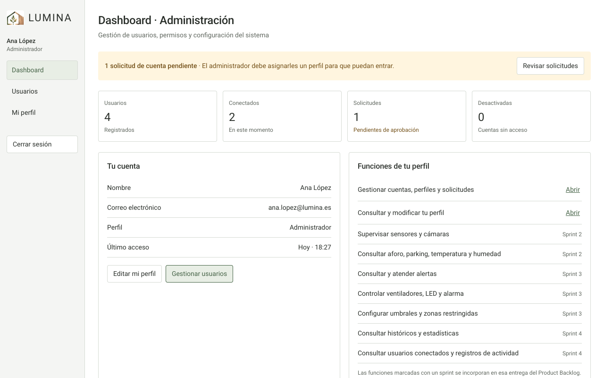

# Lumina · Sprint 1

Entrega del **Sprint 1 (19 de octubre – 1 de noviembre de 2026)** de Lumina, la plataforma de
supervisión IoT de un supermercado y su parking (Proyecto de Ingeniería Informática 1 ·
Universidad Europea · 2026-27). Solo contiene el alcance de este sprint:

| Historia | Contenido | Dónde |
| -------- | --------- | ----- |
| H1.1 Arquitectura MVC y esquemas JSON | Modelo de datos, contratos de lectura/escritura y esquemas de usuarios, sensores, actuadores, alertas e históricos | `lumina/models`, `lumina/repositories`, `schemas/`, `docs/esquemas-json.md` |
| H1.2 Registro, login y cierre de sesión | Solicitud de cuenta, validación de credenciales, dashboard según el rol, cierre de sesión | `views/pages/auth.py`, `views/pages/dashboard.py`, `controllers/auth.py` |
| H1.3 Administración de usuarios y roles | Listado, alta, **edición**, desactivación y asignación de perfil (solo administración) | `views/pages/users.py`, `controllers/users.py` |
| H1.4 Mi perfil | Consulta y cambio de nombre, correo y contraseña de la propia cuenta | `views/pages/profile.py` |

La supervisión, las alertas, los actuadores, los históricos, la configuración y los registros
de actividad llegan en los Sprints 2 a 4; el dashboard indica en qué sprint aparece cada función.



## Puesta en marcha

```bash
python3 -m venv .venv && source .venv/bin/activate     # Windows: .venv\Scripts\activate
pip install -r requirements-dev.txt
python main.py                                         # abre la ventana de Lumina
```

Cuentas de demostración: `ana.lopez@lumina.es` / `admin123` (Administrador),
`carlos.ruiz@lumina.es` / `seguridad123` (Seguridad), `marta.garcia@lumina.es` / `gerente123` (Gerente).
Para usarla en el navegador: `LUMINA_NATIVE=false python main.py`.

## Demostración del sprint

1. Solicitar una cuenta en «Registrarse»: queda pendiente de aprobación.
2. Entrar con credenciales válidas (y ver el error con unas inválidas).
3. Cada perfil abre su propio dashboard con sus funciones.
4. Como administrador: aprobar la solicitud asignando un perfil, crear, editar y desactivar cuentas.
5. Con otro usuario: modificar nombre, correo o contraseña en «Mi perfil».
6. Cerrar sesión y comprobar que las pantallas protegidas ya no son accesibles.

Capturas de todas las pantallas en [`docs/capturas`](docs/capturas).

## Calidad

```bash
pytest          # 152 tests: datos y esquemas, controladores, interfaz, escritorio y reglas del proyecto
mypy            # tipado estricto
ruff check .
```

## Ejecutable

`python scripts/empaquetar.py` crea `dist/Lumina Sprint 1.app` (macOS) o la carpeta del programa
en `dist/` (Windows, generándolo en Windows). Sus datos se guardan aparte de los de otras versiones,
en `~/Library/Application Support/Lumina Sprint 1` (macOS) o `%APPDATA%\Lumina Sprint 1` (Windows).
