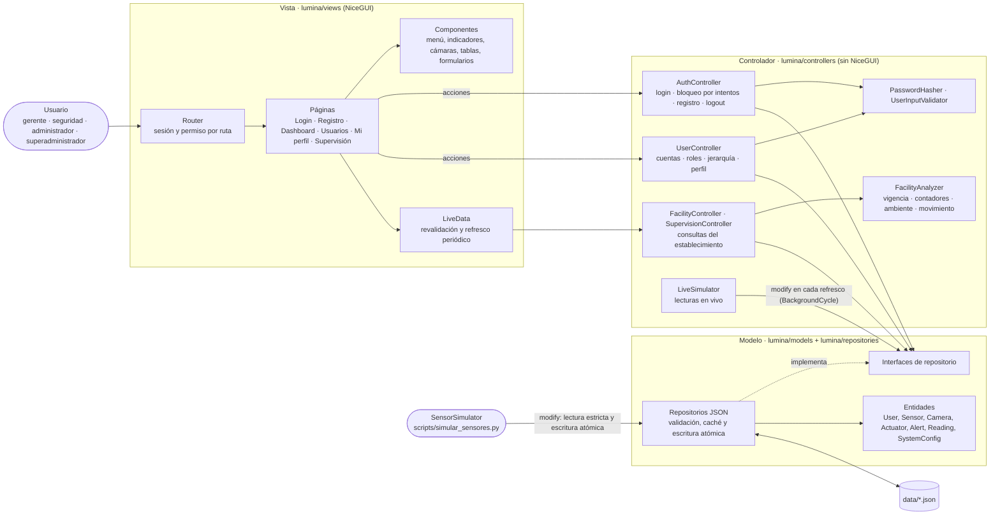
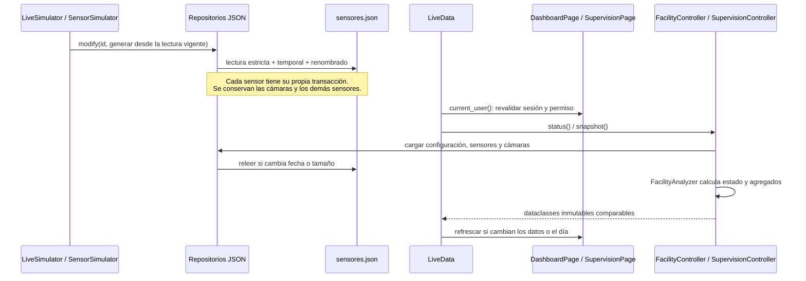
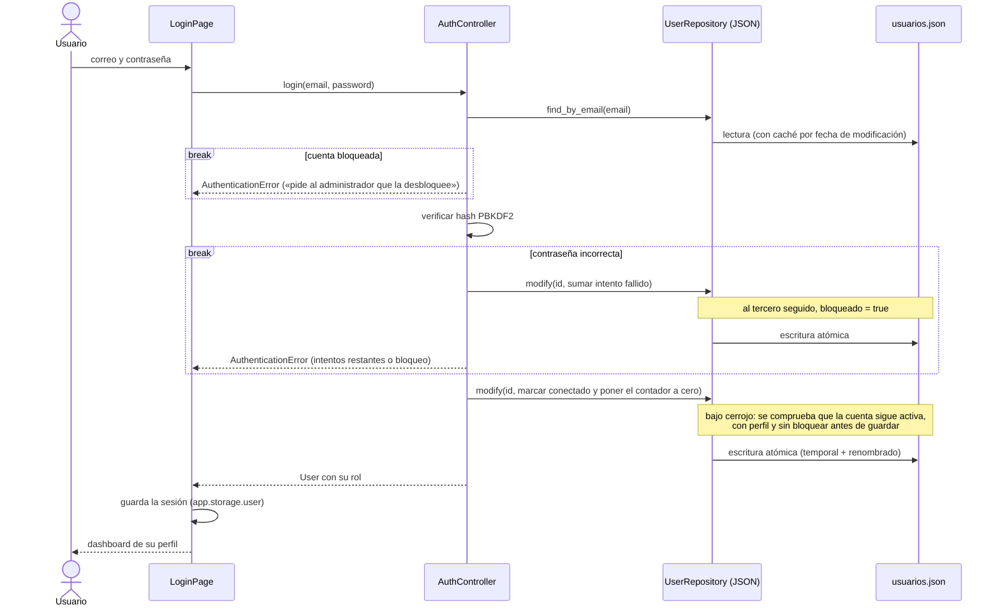
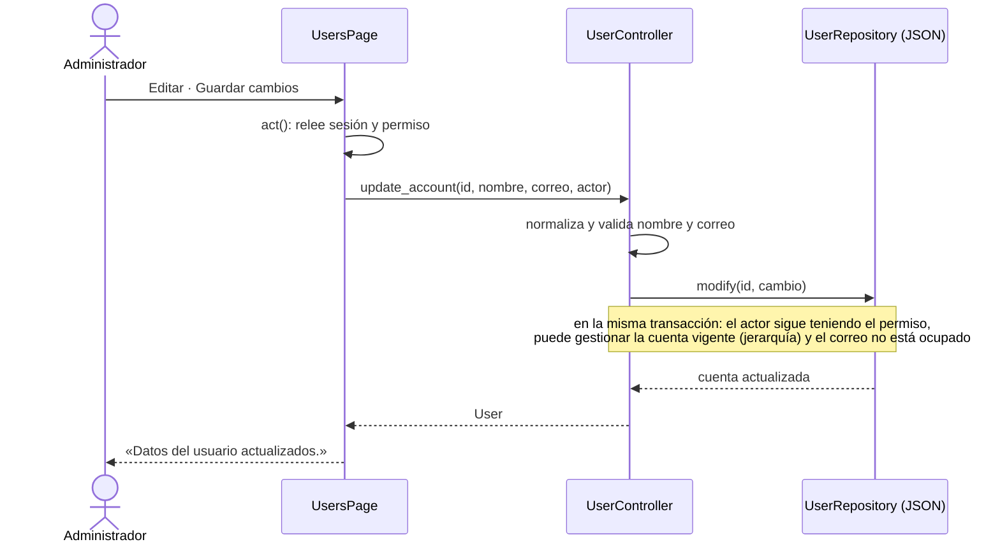

# Arquitectura de Lumina (Sprints 1 y 2)

Lumina sigue el patrón **Modelo–Vista–Controlador** del anteproyecto (apartado 4.1.3): Python
para la lógica, NiceGUI para la interfaz y ficheros JSON como almacenamiento de la fase 1. Se
ejecuta como aplicación de escritorio: un servidor local (solo `127.0.0.1`) y una ventana propia.

## Diagrama de componentes

## Capas y reglas

| Capa | Carpeta | Responsabilidad | Regla |
| ---- | ------- | --------------- | ----- |
| Modelo | `lumina/models` | Entidades inmutables, enumerados y variables calculadas (`UserCounts`, `FacilityStatus`, `SupervisionSnapshot`…) | Sin dependencias de E/S |
| Modelo | `lumina/repositories` | Contratos de lectura/escritura (`interfaces.py`) y su implementación JSON | Solo aquí se tocan ficheros |
| Controlador | `lumina/controllers` | Acceso, usuarios, vigencia, aforo, ambiente y detecciones | No importa NiceGUI: se prueba sin interfaz |
| Vista | `lumina/views` | Pantallas (una clase por pantalla), componentes y tema visual | No lee ficheros; solo Python (sin JavaScript, CSS ni HTML a mano) |
| Arranque | `main.py`, `lumina/launcher.py`, `lumina/app.py` | Prepara el proceso, une las tres capas, programa la simulación en vivo (`BackgroundCycle`) y abre la ventana | — |

Las reglas se comprueban automáticamente: `mypy --strict` (tipos), `tests/test_project_rules.py`
(nada de JavaScript, Vue ni CSS en la interfaz) y `tests/test_desktop.py` (el lanzador no carga NiceGUI).

## Cómo se comunican la vista, la lógica y el almacenamiento

1. **Rutas.** `Router` registra cada pantalla en NiceGUI. En cada visita comprueba la sesión
   (el `id` del usuario en `app.storage.user`) y el permiso del rol; si no procede, redirige al
   inicio de sesión o al dashboard sin llegar a construir la página.
2. **Acciones.** Un botón llama a un método del controlador a través de `ProtectedPage.act()`, que
   vuelve a leer la sesión y el permiso en ese momento y muestra el resultado (o el error de
   negocio) como notificación. Así, quitar el permiso a alguien surte efecto en las páginas que ya
   tenía abiertas.
3. **Lógica.** El controlador valida los datos, aplica las reglas y usa los repositorios por su
   interfaz (`UserRepository`…), nunca los ficheros.
4. **Datos.** El repositorio JSON traduce entre entidades y JSON (claves en español), valida tipos
   con mensajes que indican fichero, posición y campo, y guarda de forma atómica.
5. **Refresco.** Las pantallas con datos cambiantes usan `LiveData`, que los relee cada
   `LUMINA_REFRESH_SECONDS` y redibuja si cambian los datos o el día actual del reloj.
   Cada consulta revalida la sesión y el permiso; una cuenta desactivada vuelve al login y un
   perfil sin permiso de supervisión vuelve al dashboard, sin consultar de nuevo el lector y
   desactivando su temporizador. También se recalcula la vigencia aunque el fichero no haya
   cambiado. Si falla la primera lectura, `value` es `None`, se avisa y se sigue reintentando;
   los bloques independientes del dashboard siguen visibles. Tras una lectura válida se
   conserva ese valor durante fallos posteriores. Un intervalo de cero desactiva el refresco periódico.

### Sensores y refresco (H2.1–H2.4)

`FacilityController.status` alimenta aforo, plazas y ambiente de todos los dashboards.
`SupervisionController.snapshot` alimenta exclusivamente cámaras, movimiento por zona y
lecturas. `FacilityAnalyzer` concentra las reglas puras. `SensorState` distingue el estado
efectivo de presentación del `SensorStatus` persistido: «Sin datos» no añade un valor al esquema.
Los valores NaN y ±infinito son errores de datos del sensor: se clasifican como «Error», se
excluyen de los agregados y detecciones y se presentan como «Lectura inválida» con su unidad.

La zona ambiental se obtiene de `zona_principal`; se muestran medias solo de sus sensores
operativos, con la hora más antigua de los contribuyentes. Los contadores operativos se suman,
se redondean a personas/plazas enteras y se acotan entre cero y capacidad, conservando en la
lista de sensores la lectura original. Sin contadores operativos el agregado es cero y su hora
es desconocida. Las zonas sin sensor de movimiento operativo muestran su indisponibilidad,
nunca una ausencia de movimiento inventada. Las reglas y sus prioridades están en
[sprint-2.md](sprint-2.md#decisiones-de-implementación).

**Datos en vivo.** Mientras no haya maqueta física, la propia aplicación hace de sensores:
`LuminaApp` programa un `BackgroundCycle` que, cada `LUMINA_REFRESH_SECONDS`, ejecuta
`LiveSimulator.step()` en un hilo (sin bloquear la interfaz, sin solaparse y esperando el ciclo
en curso al cerrar). Cada sensor operativo recibe una lectura nueva y verosímil mediante
`modify`: temperatura y humedad oscilan alrededor de su valor habitual con un ciclo diario suave,
aforo y parking siguen la afluencia de cada hora sin salir de [0, capacidad], la distancia del
acceso baja al pasar un coche y el movimiento aparece de forma breve y esporádica. Todas las
lecturas renuevan su hora, así que las pantallas nunca muestran siempre el mismo dato. No inventa
lecturas ausentes ni repara sensores en error o desactualizados, y si otra fuente escribe un
sensor (la maqueta, `SensorSimulator` desde la terminal…) se lo deja durante dos minutos desde
su última escritura. `LUMINA_SIMULATION=false` la desactiva; los tests la desactivan por defecto.
`SensorSimulator` (`scripts/simular_sensores.py`) sigue disponible como escritor externo.

**Cámaras.** `CameraTile` reproduce en bucle, sin sonido ni controles, el vídeo de la URL de la
cámara (`.mp4`, `.webm`…), con el rótulo «EN DIRECTO», la hora sobreimpresa que avanza cada
segundo y un aviso «Sin señal de vídeo» si el navegador no puede reproducirlo. Los datos de
ejemplo apuntan a grabaciones reales de videovigilancia de una tienda y de un aparcamiento
(dominio público, Wikimedia Commons). Una URL de imagen o MJPEG se muestra como imagen y, sin
URL, se mantiene la vista simulada o «Cámara sin conexión», con la detección de la zona aparte.
`SupervisionPage` construye las cámaras una sola vez y en cada refresco solo cambia sus rótulos,
de modo que el vídeo no se reinicia. No se añade captura de vídeo físico ni almacenamiento.

### Inicio de sesión (H1.2)

Tras `MAX_FAILED_ATTEMPTS` (3) contraseñas incorrectas seguidas la cuenta queda bloqueada en
`usuarios.json`; la desbloquea desde «Usuarios» (`UserController.unlock`) un administrador o, si
es una cuenta de administración, el superadministrador.

### Edición de una cuenta por el administrador (H1.3)

## Control de acceso por roles

Los permisos salen de los casos de uso del anteproyecto (`lumina/models/enums.py`):

| Permiso | Gerente | Seguridad | Administrador | Superadministrador | Sprint |
| ------- | :-----: | :-------: | :-----------: | :----------------: | :----: |
| `gestionar_usuarios` (cuentas, roles, solicitudes, desbloqueos) | | | ✓ | ✓ | 1 |
| `gestionar_administradores` (perfil, datos, activación y desbloqueo de administradores) | | | | ✓ | 2 |
| `ver_establecimiento` (aforo, parking, clima) | ✓ | ✓ | ✓ | ✓ | 2 |
| `supervisar` (sensores y cámaras) | | ✓ | ✓ | ✓ | 2 |
| `gestionar_alertas` | | ✓ | ✓ | ✓ | 3 |
| `controlar_actuadores` | | ✓ | ✓ | ✓ | 3 |
| `configurar_sistema` (umbrales y zonas) | | | ✓ | ✓ | 3 |
| `ver_historicos` (históricos y estadísticas) | ✓ | ✓ | ✓ | ✓ | 4 |
| `ver_registros` (conectados y actividad) | | | ✓ | ✓ | 4 |

**Jerarquía de cuentas.** Superadministrador > administrador > seguridad y gerencia. Una cuenta
con `gestionar_usuarios` solo modifica cuentas de rango inferior al suyo y solo asigna perfiles
inferiores (`Role.can_manage`, `User.can_manage`). Por eso **los administradores no se pueden
modificar entre sí** ni dar de alta o ascender administradores: el superadministrador es quien
gestiona sus perfiles y permisos, sus datos, su activación («cerrar la cuenta») y su desbloqueo.
El perfil `superadmin` no lo asigna ni lo modifica nadie desde la aplicación. `UserController`
lo comprueba con las versiones vigentes de las dos cuentas dentro de la transacción que guarda
el cambio, y «Usuarios» solo ofrece controles en las filas que quien mira puede gestionar.

«Mi perfil» está disponible para todos. El acceso se comprueba en tres sitios: el **menú** solo
muestra lo permitido, el **router** rechaza la ruta y el **controlador** vuelve a comprobar el
permiso del actor en las acciones de escritura (en la misma transacción que guarda el cambio).
Las consultas de supervisión son de solo lectura y se protegen mediante
`SupervisionPage.permission = Permission.SUPERVISE`, tanto al entrar como en cada `LiveData`.

Otras medidas: contraseñas con PBKDF2-SHA256 y sal aleatoria (nunca en claro); una solicitud sin
perfil y una cuenta desactivada no pueden entrar; tres contraseñas incorrectas seguidas bloquean la
cuenta hasta que la desbloquea quien puede gestionarla; la sesión dura lo que la ventana (clave
aleatoria por ejecución) y al cerrarla la cuenta queda desconectada.

## Persistencia en JSON

- **Lectura con caché**: un fichero solo se vuelve a leer si cambia su fecha o su tamaño.
- **Tolerancia**: si otro proceso deja un JSON a medias, la interfaz sigue mostrando la última
  versión válida durante unos segundos; las **escrituras**, en cambio, exigen la versión actual.
- **Escritura atómica**: fichero temporal en la misma carpeta y renombrado.
- **Transacciones**: `Repository.modify()` lee, cambia y guarda bajo un mismo cerrojo; `add()`
  admite una comprobación (`check`) dentro de esa transacción. Así no se pisan cambios simultáneos.
- **Contrato**: `schemas/*.schema.json` describe cada fichero (ver [esquemas-json.md](esquemas-json.md)).
  `scripts/documentar_esquemas.py` regenera sus tablas con la biblioteca estándar y
  `tests/test_schema_documentation.py` comprueba que el documento esté al día.
- **Una sola instancia** por carpeta de datos (bloqueo del sistema sobre `data/.lumina.lock`).

## Aplicación de escritorio

`main.py` → `Launcher` (registro de diagnóstico en el ejecutable, bloqueo de instancia, sesiones de
la ventana, datos iniciales) → `LuminaApp` (une Modelo, Controlador y Vista) → NiceGUI en modo
nativo: servidor en `127.0.0.1` y ventana con pywebview. `scripts/empaquetar.py` lo convierte en
ejecutable con PyInstaller.

## Cómo crece en los siguientes sprints

- **Sprint 3**: configuración, alertas, actuadores y reglas automáticas; sus contratos JSON
  existen desde H1.1, pero no se consultan ni se modifican en los nuevos controladores del Sprint 2.
- **Sprint 4**: históricos, estadísticas, registros y validación final. No se añaden a esta entrega.
- **Fase 2 (base de datos)**: basta con implementar las interfaces de `repositories/interfaces.py`
  (p. ej. `SqlUserRepository`) y pasar otro `Repositories` a `Services.create()`; controladores y
  vistas no cambian.
