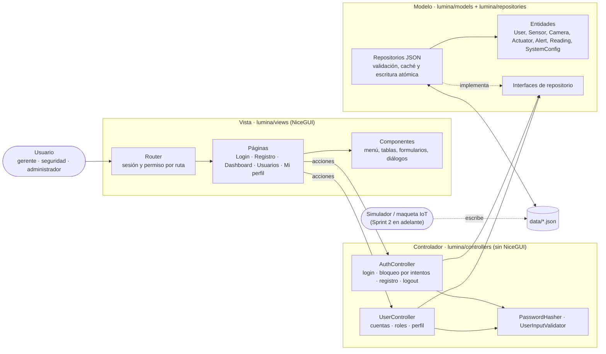
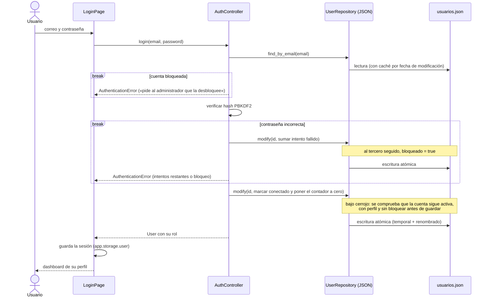
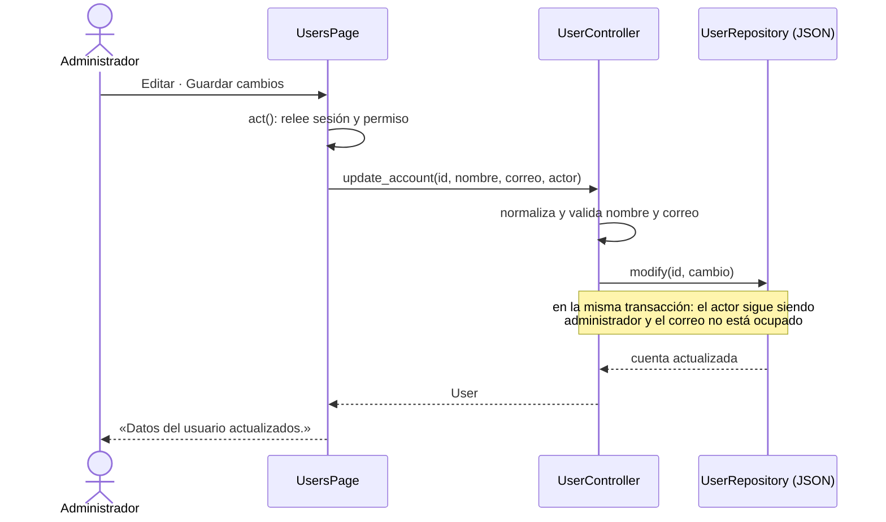

# Arquitectura de Lumina (H1.1)

Lumina sigue el patrón **Modelo–Vista–Controlador** del anteproyecto (apartado 4.1.3): Python
para la lógica, NiceGUI para la interfaz y ficheros JSON como almacenamiento de la fase 1. Se
ejecuta como aplicación de escritorio: un servidor local (solo `127.0.0.1`) y una ventana propia.

## Diagrama de componentes

## Capas y reglas

| Capa | Carpeta | Responsabilidad | Regla |
| ---- | ------- | --------------- | ----- |
| Modelo | `lumina/models` | Entidades inmutables (`User`, `Sensor`…), enumerados (roles, permisos, tipos) y variables calculadas (`UserCounts`) | Sin dependencias de E/S |
| Modelo | `lumina/repositories` | Contratos de lectura/escritura (`interfaces.py`) y su implementación JSON | Solo aquí se tocan ficheros |
| Controlador | `lumina/controllers` | Reglas de negocio: credenciales, solicitudes, roles, permisos, validación | No importa NiceGUI: se prueba sin interfaz |
| Vista | `lumina/views` | Pantallas (una clase por pantalla), componentes y tema visual | No lee ficheros; solo Python (sin JavaScript, CSS ni HTML a mano) |
| Arranque | `main.py`, `lumina/launcher.py`, `lumina/app.py` | Prepara el proceso, une las tres capas y abre la ventana | — |

Las reglas se comprueban automáticamente: `mypy --strict` (tipos), `tests/test_project_rules.py`
(nada de JavaScript, Vue ni CSS en la interfaz) y `tests/test_desktop.py` (el lanzador no carga NiceGUI).

## Cómo se comunican la vista, la lógica y el almacenamiento

1. **Rutas.** `Router` registra cada pantalla en NiceGUI. En cada visita comprueba la sesión
   (el `id` del usuario en `app.storage.user`) y el permiso del rol; si no procede, redirige al
   inicio de sesión o al dashboard sin llegar a construir la página.
2. **Acciones.** Un botón llama a un método del controlador a través de `ProtectedPage.act()`, que
   vuelve a leer la sesión y el permiso en ese momento y muestra el resultado (o el error de
   negocio) como notificación. Así, quitar el permiso a alguien surte efecto en las páginas que ya
   tenía abiertas.
3. **Lógica.** El controlador valida los datos, aplica las reglas y usa los repositorios por su
   interfaz (`UserRepository`…), nunca los ficheros.
4. **Datos.** El repositorio JSON traduce entre entidades y JSON (claves en español), valida tipos
   con mensajes que indican fichero, posición y campo, y guarda de forma atómica.
5. **Refresco.** Las pantallas con datos cambiantes usan `LiveData`, que los relee cada
   `LUMINA_REFRESH_SECONDS` y solo redibuja si cambian: lo que escriba otro proceso aparece solo.

### Inicio de sesión (H1.2)

Tras `MAX_FAILED_ATTEMPTS` (3) contraseñas incorrectas seguidas la cuenta queda bloqueada en
`usuarios.json`; solo un administrador la desbloquea, desde «Usuarios» (`UserController.unlock`).

### Edición de una cuenta por el administrador (H1.3)

## Control de acceso por roles

Los permisos salen de los casos de uso del anteproyecto (`lumina/models/enums.py`):

| Permiso | Gerente | Seguridad | Administrador | Sprint |
| ------- | :-----: | :-------: | :-----------: | :----: |
| `gestionar_usuarios` (cuentas, roles, solicitudes, desbloqueos) | | | ✓ | 1 |
| `ver_establecimiento` (aforo, parking, clima) | ✓ | ✓ | ✓ | 2 |
| `supervisar` (sensores y cámaras) | | ✓ | ✓ | 2 |
| `gestionar_alertas` | | ✓ | ✓ | 3 |
| `controlar_actuadores` | | ✓ | ✓ | 3 |
| `configurar_sistema` (umbrales y zonas) | | | ✓ | 3 |
| `ver_historicos` (históricos y estadísticas) | ✓ | ✓ | ✓ | 4 |
| `ver_registros` (conectados y actividad) | | | ✓ | 4 |

«Mi perfil» está disponible para todos. El acceso se comprueba en tres sitios: el **menú** solo
muestra lo permitido, el **router** rechaza la ruta y el **controlador** vuelve a comprobar el
permiso del actor (en la misma transacción que guarda el cambio).

Otras medidas: contraseñas con PBKDF2-SHA256 y sal aleatoria (nunca en claro); una solicitud sin
perfil y una cuenta desactivada no pueden entrar; tres contraseñas incorrectas seguidas bloquean la
cuenta hasta que un administrador la desbloquea; la sesión dura lo que la ventana (clave
aleatoria por ejecución) y al cerrarla la cuenta queda desconectada.

## Persistencia en JSON

- **Lectura con caché**: un fichero solo se vuelve a leer si cambia su fecha o su tamaño.
- **Tolerancia**: si otro proceso deja un JSON a medias, la interfaz sigue mostrando la última
  versión válida durante unos segundos; las **escrituras**, en cambio, exigen la versión actual.
- **Escritura atómica**: fichero temporal en la misma carpeta y renombrado.
- **Transacciones**: `Repository.modify()` lee, cambia y guarda bajo un mismo cerrojo; `add()`
  admite una comprobación (`check`) dentro de esa transacción. Así no se pisan cambios simultáneos.
- **Contrato**: `schemas/*.schema.json` describe cada fichero (ver [esquemas-json.md](esquemas-json.md)).
- **Una sola instancia** por carpeta de datos (bloqueo del sistema sobre `data/.lumina.lock`).

## Aplicación de escritorio

`main.py` → `Launcher` (registro de diagnóstico en el ejecutable, bloqueo de instancia, sesiones de
la ventana, datos iniciales) → `LuminaApp` (une Modelo, Controlador y Vista) → NiceGUI en modo
nativo: servidor en `127.0.0.1` y ventana con pywebview. `scripts/empaquetar.py` lo convierte en
ejecutable con PyInstaller.

## Cómo crece en los siguientes sprints

- **Sprint 2–4**: cada historia añade un controlador (`SupervisionController`, `HistoryController`…),
  su página y su entrada en el menú; el modelo y los repositorios de sensores, actuadores, alertas
  e históricos ya existen y están probados.
- **Fase 2 (base de datos)**: basta con implementar las interfaces de `repositories/interfaces.py`
  (p. ej. `SqlUserRepository`) y pasar otro `Repositories` a `Services.create()`; controladores y
  vistas no cambian.
