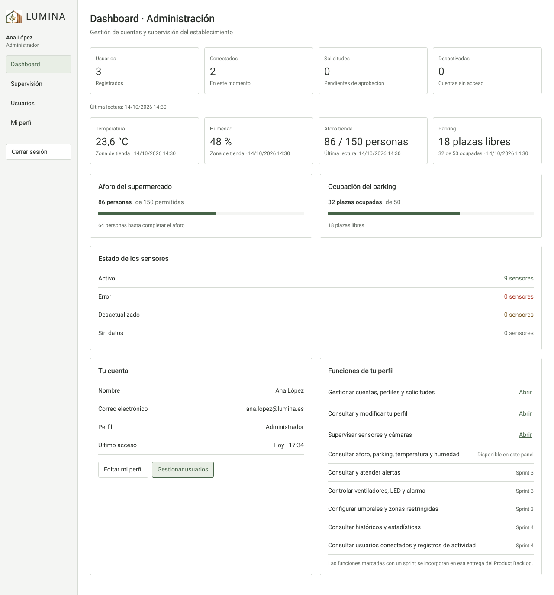
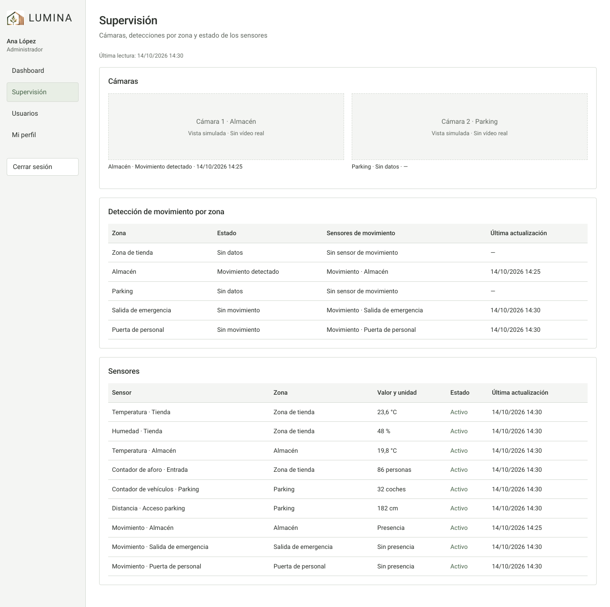
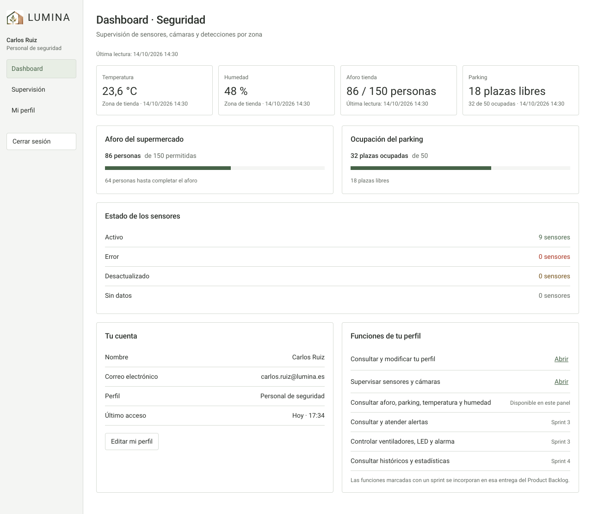
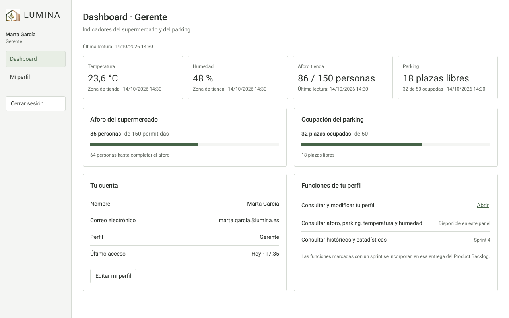
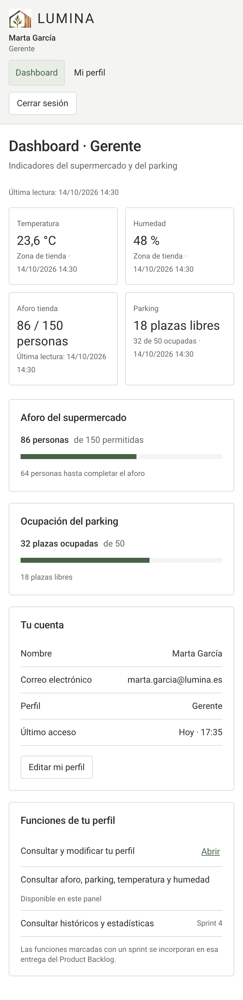

# Entrega del Sprint 2 de Lumina

Proyecto de Ingeniería Informática 1 · Universidad Europea · curso 2026-27.
**Fechas:** del 2 al 15 de noviembre de 2026, ambos incluidos.
**Planificación:** cuatro historias y 32 horas (10 + 8 + 6 + 8).

El objetivo es supervisar las lecturas IoT del supermercado y su parking: valores y salud
de los sensores, aforo y plazas, temperatura y humedad, cámaras y detecciones por zona.
Se parte de la entrega completa del Sprint 1 y se conservan sus pantallas, protecciones,
pruebas, documentación y capturas, incluido el bloqueo tras tres contraseñas incorrectas
seguidas que se añadió al Sprint 1 el 29/10/2026. Solo se implementan las cuatro historias del Sprint 2.
El 04/11/2026 se incorporaron tres mejoras pedidas en la revisión, descritas en
[su apartado](#ampliación-del-04112026-superadministrador-cámaras-con-vídeo-y-datos-en-vivo):
superadministrador (los administradores no se modifican entre sí), cámaras con vídeo real y
datos en vivo que cambian continuamente.

## Trazabilidad con el Product Backlog

Los criterios entre comillas son literales. Las funciones de prueba nombradas existen;
las parametrizadas cubren varios casos. Las cámaras del almacén supervisan el interior
del supermercado y la segunda cámara supervisa el parking, como en los datos y el mockup.

| Historia | Responsable | Horas | Criterio de aceptación literal | Dónde está implementado | Tests que lo prueban |
| --- | --- | ---: | --- | --- | --- |
| **H2.1 · Valores y estado de sensores · RF-04 / RNF-03 · Imprescindible** | Ignacio Torres | 10 | «Se muestran valores, unidad y estado; si falta una lectura o supera el tiempo de vigencia aparece estado sin datos/desactualizado.» | [controllers/analysis.py](../lumina/controllers/analysis.py) (`sensor_state`, `health`), [controllers/supervision.py](../lumina/controllers/supervision.py), [models/status.py](../lumina/models/status.py) (`SensorHealth`, `SensorState`), [components/facility.py](../lumina/views/components/facility.py) (`SensorTable`, `SensorSummary`), [pages/supervision.py](../lumina/views/pages/supervision.py), [scripts/simular_sensores.py](../scripts/simular_sensores.py). | En [test_facility.py](../tests/test_facility.py): `test_sensor_state_rules`, `test_reading_without_timestamp`, `test_old_readings_are_reported_as_stale`. En [test_supervision_ui.py](../tests/test_supervision_ui.py): `test_security_and_admin_see_cameras_zones_and_sensor_values`, `test_supervision_shows_missing_failed_and_stale_readings`. En [test_simulator.py](../tests/test_simulator.py): `test_simulator_writes_readings_that_follow_the_sensor_schema`, `test_simulator_revalidates_the_sensor_inside_modify`, `test_simulator_never_overwrites_an_incomplete_file`. |
| **H2.2 · Aforo y aparcamiento · RF-05 · Imprescindible** | Víctor Rodríguez | 8 | «Se muestra aforo en personas y aparcamiento en plazas; libres = capacidad − ocupadas; valores acotados entre 0 y capacidad.» | [controllers/analysis.py](../lumina/controllers/analysis.py) (`capacity`), [controllers/facility.py](../lumina/controllers/facility.py), [models/status.py](../lumina/models/status.py) (`CapacityStatus`), [components/facility.py](../lumina/views/components/facility.py) (`FacilityMetrics`, `OccupancyPanels`), [components/data.py](../lumina/views/components/data.py) (`ProgressMeter`), [scripts/simular_sensores.py](../scripts/simular_sensores.py). | En [test_facility.py](../tests/test_facility.py): `test_facility_status_matches_the_mockup`, `test_counter_values_are_bounded`, `test_counters_sum_all_operational_sensors`. En [test_simulator.py](../tests/test_simulator.py): `test_simulator_supports_entries_and_exits`, `test_simulator_bounds_each_counter`. En [test_supervision_ui.py](../tests/test_supervision_ui.py): `test_all_dashboards_show_occupancy_climate_units_and_reading_times`. |
| **H2.3 · Temperatura y humedad · RF-06 · Imprescindible** | Víctor Rodríguez | 6 | «Los indicadores muestran °C y % de la lectura JSON y su hora; la interfaz refleja nuevas lecturas simuladas.» | [controllers/analysis.py](../lumina/controllers/analysis.py) (`climate`), [controllers/facility.py](../lumina/controllers/facility.py), [components/facility.py](../lumina/views/components/facility.py), [pages/dashboard.py](../lumina/views/pages/dashboard.py), [pages/base.py](../lumina/views/pages/base.py) (`LiveData`), [formatting.py](../lumina/views/formatting.py), [scripts/simular_sensores.py](../scripts/simular_sensores.py). | En [test_facility.py](../tests/test_facility.py): `test_facility_status_matches_the_mockup`, `test_climate_averages_main_zone_and_keeps_its_reading_time`. En [test_supervision_ui.py](../tests/test_supervision_ui.py): `test_all_dashboards_show_occupancy_climate_units_and_reading_times`, `test_new_json_readings_refresh_the_open_screen`, `test_simulator_updates_dashboard_without_reload`. |
| **H2.4 · Cámaras y detecciones por zona · RF-07 · Importante** | Ignacio Torres | 8 | «Las cámaras de almacén y parking son visibles para Seguridad y Administración; las detecciones muestran zona y estado.» | [controllers/supervision.py](../lumina/controllers/supervision.py), [controllers/analysis.py](../lumina/controllers/analysis.py) (`motion`), [models/status.py](../lumina/models/status.py) (`ZoneMotion`, `CameraFeed`, `SupervisionSnapshot`), [pages/supervision.py](../lumina/views/pages/supervision.py), [components/camera.py](../lumina/views/components/camera.py), [components/facility.py](../lumina/views/components/facility.py) (`MotionTable`), [routes.py](../lumina/views/routes.py). | En [test_facility.py](../tests/test_facility.py): `test_supervision_has_cameras_motion_zones_and_readings`, `test_motion_combines_sensors_and_excludes_errors`, `test_motion_stale_or_missing_never_claims_no_movement`, `test_unconfigured_zones_keep_their_identifier`. En [test_supervision_ui.py](../tests/test_supervision_ui.py): `test_security_and_admin_see_cameras_zones_and_sensor_values`, `test_manager_cannot_see_cameras_even_by_direct_route`, `test_camera_url_is_rendered_and_offline_camera_keeps_zone_detection`, `test_open_supervision_revalidates_session_and_permission`. |

`test_sprint_two_queries_do_not_read_future_modules` comprueba que los nuevos controladores
funcionan incluso con alertas, actuadores e históricos ilegibles: no los consultan.
`test_protected_pages_require_a_session`, en [test_ui.py](../tests/test_ui.py), incluye
`/supervision`. Las regresiones de sesión, acciones autorizadas y carreras del Sprint 1
permanecen en su batería original.

Las correcciones de auditoría se cubren en `test_facility.py` con
`test_nonfinite_json_readings_are_errors_and_never_contribute` (incluido `1e309`) y
`test_nonfinite_sensors_do_not_change_valid_aggregates`. En `test_supervision_ui.py`,
`test_nonfinite_readings_never_break_dashboard_or_supervision` comprueba ambas pantallas;
`test_initial_malformed_json_recovers_without_reload` repara el fichero tras el primer fallo;
`test_relative_dates_refresh_at_midnight_without_json_changes` avanza `FixedClock` sin cambiar
los sensores. `test_open_supervision_revalidates_session_and_permission` comprueba también
que no aumentan las llamadas al lector y que el temporizador queda desactivado al perder acceso.

## Tareas del anteproyecto

- [x] **2.1.1 · Crear el generador/lector de datos de sensores (temperatura, humedad y movimiento).**
  Lectura mediante `SensorRepository` / `JsonSensorRepository`; generación con
  `SensorSimulator`, con movimiento opcional y escritura por `modify`.
- [x] **2.1.2 · Mostrar una lista con el estado de cada sensor (Activo / Error).** `SensorTable`
  añade también Desactualizado y Sin datos, como exige el criterio literal, junto a la zona,
  el valor con unidad y su última actualización. El dashboard autorizado muestra un resumen.
- [x] **2.2.1 · Lógica del contador de personas y de coches.** Suma de contadores operativos,
  límites de capacidad en `FacilityAnalyzer.capacity`; entradas/salidas en el simulador.
- [x] **2.2.2 · Tarjetas con el aforo actual y las plazas libres.** `FacilityMetrics` para todos
  los perfiles y barras accesibles de ocupación mediante `OccupancyPanels` / `ProgressMeter`.
- [x] **2.3.1 · Indicadores de temperatura y humedad.** Valores en °C y %, con hora propia y
  zona principal; formato decimal español mediante `Formatter`.
- [x] **2.3.2 · Conectarlos con los datos actualizados de los sensores.** `FacilityController`
  obtiene el JSON mediante repositorios y `DashboardPage` lo relee con `self.live(...)`.
- [x] **2.4.1 · Cuadrícula de cámaras (vídeo o simulación) para tienda y parking.** `CameraGrid`
  y `CameraTile` muestran almacén del supermercado y parking. Una URL activa muestra su imagen
  o flujo MJPEG; sin URL hay una vista explícitamente simulada, como permite el criterio.
- [x] **2.4.2 · Mostrar qué sensores de movimiento detectan presencia en cada zona.** `MotionTable`
  identifica los sensores de cada zona; `SensorTable` detalla Presencia / Sin presencia,
  estado y hora individuales. Cada cámara muestra también la detección agregada de su zona.

## Guion de demostración en seis pasos

Crear el entorno propio de la entrega e instalar dependencias siguiendo [README.md](../README.md).
Para conservar los datos originales, preparar una copia (comandos de macOS/Linux):

```bash
cp -R data /tmp/lumina-sprint2-demo
LUMINA_DATA_DIR=/tmp/lumina-sprint2-demo LUMINA_REFRESH_SECONDS=1 .venv/bin/python main.py
```

Estos comandos son para la demostración manual; los tests no abren la aplicación nativa.
Si se repite, eliminar o cambiar la carpeta de demostración antes de copiar los datos.
Cuentas iniciales:

| Perfil | Correo | Contraseña |
| --- | --- | --- |
| Superadministrador | `elena.navarro@lumina.es` | `superadmin123` |
| Administrador | `ana.lopez@lumina.es` | `admin123` |
| Administrador | `javier.moreno@lumina.es` | `admin123` |
| Seguridad | `carlos.ruiz@lumina.es` | `seguridad123` |
| Gerente | `marta.garcia@lumina.es` | `gerente123` |

La aplicación arranca con los **datos en vivo** activados: desde la primera lectura los valores
y sus horas son los de ese momento. Para enseñar los valores de ejemplo exactos del 14/10/2026
(pasos 1 y 4), arrancar con `LUMINA_SIMULATION=false` en la línea anterior.

1. **Indicadores del gerente.** Entrar con Marta. Mostrar `86 / 150 personas`, `18 plazas libres`,
   `32 de 50 ocupadas`, `23,6 °C` y `48 %`, con hora `14:30` del 14/10/2026. La fecha inicial
   se conserva del Sprint 1 y se muestra sin aparentar que es una lectura de hoy. Explicar
   las barras de ocupación, «Tu cuenta» y «Funciones de tu perfil». No aparece un enlace
   «Abrir» hacia el propio dashboard.
2. **Datos simulados y refresco.** Con los datos en vivo activados, basta con esperar: cada
   refresco cambia temperatura, humedad, aforo, parking, distancia y detecciones, y renueva sus
   horas. Para usar el simulador externo, en otra terminal, con el entorno del Sprint 2 activado:

   ```bash
   .venv/bin/python scripts/simular_sensores.py --datos /tmp/lumina-sprint2-demo --intervalo 3 --semilla 7 --movimiento
   ```

   Observar los cambios de temperatura, humedad, aforo y parking sin recargar. Se actualizan
   los instantes de lectura. Detener con Ctrl+C. Se puede añadir `--ciclos 10`; sin
   `--movimiento`, los sensores de movimiento permanecen intactos. Mientras escribe, la
   simulación interna deja esos sensores en sus manos y los retoma dos minutos después.
3. **Supervisión de seguridad.** Cerrar sesión y esperar a «Iniciar sesión». Entrar con Carlos,
   mostrar el resumen de sensores y pulsar «Supervisión». Mostrar las dos cámaras con vídeo en
   directo (tienda y parking, con «EN DIRECTO» y la hora que avanza), sus zonas/detecciones, la
   lista de zonas y la tabla con valores, unidades y últimas horas. El vídeo necesita conexión a
   Internet; sin ella cada cámara indica «Sin señal de vídeo» y mantiene su detección.
   Cada sensor de movimiento indica Presencia / Sin presencia. Sin sensor de movimiento en
   parking aparece Sin datos, no una ausencia de movimiento supuesta.
4. **Estados excepcionales.** Con el simulador detenido, preparar tres lecturas en la copia de
   demostración mediante los repositorios (desde la raíz, con el entorno activado):

   ```python
   from dataclasses import replace
   from datetime import datetime, timedelta
   from pathlib import Path
   from lumina.models import SensorStatus
   from lumina.repositories import Repositories

   repos = Repositories.from_json_dir(Path('/tmp/lumina-sprint2-demo'))
   repos.config.save(replace(repos.config.load(), max_reading_age_minutes=10))
   repos.sensors.modify('temp-tienda', lambda sensor: replace(sensor, value=None))
   repos.sensors.modify('hum-tienda', lambda sensor: replace(sensor, status=SensorStatus.ERROR))
   repos.sensors.modify('temp-almacen', lambda sensor: replace(
       sensor, updated_at=datetime.now() - timedelta(minutes=11),
   ))
   ```

   Esperar al refresco: Sin datos, Error y Desactualizado se muestran con su lectura original
   y su hora cuando existen. Las lecturas no operativas dejan de contribuir a los indicadores.
   La modificación de configuración es preparación de datos, no una pantalla entregada.
5. **Administración y permisos.** Cerrar sesión, esperar al login y entrar con Ana. Mostrar los
   contadores de cuentas conservados, los indicadores nuevos y la misma supervisión. En «Usuarios»,
   las filas de Javier (administrador) y Elena (superadministradora) no tienen controles: «Solo el
   superadministrador». Entrar con Elena y mostrar que ella sí cambia el perfil de un
   administrador, lo desactiva o lo desbloquea, y que puede asignar el perfil de administrador. Salir,
   esperar y volver con Marta. No tiene menú de supervisión y pedir `/supervision` devuelve
   su dashboard; esta petición se verifica automáticamente sin usar un navegador en
   `test_manager_cannot_see_cameras_even_by_direct_route`.
6. **Conservar el ciclo del Sprint 1.** Mostrar «Mi perfil» y «Usuarios» con el rol adecuado,
   bloquear una cuenta distinta de la de Ana con tres contraseñas incorrectas y desbloquearla
   desde «Usuarios», cerrar sesión y comprobar que una ruta protegida solicita acceso. Con los tests se demuestra
   además la expulsión automática de supervisión al desactivar la cuenta o retirarle el rol,
   incluso sin pulsar botones. Cerrar la ventana al terminar la demostración manual.

Capturas del Sprint 2 (datos de ejemplo del 14/10/2026 14:30, tomadas antes de la ampliación del
04/11/2026: muestran las cámaras simuladas y las tres cuentas originales):

| Pantalla | Captura |
| -------- | ------- |
| Dashboard de administración |  |
| Supervisión: cámaras, detecciones por zona y sensores |  |
| Dashboard de seguridad |  |
| Dashboard del gerente |  |
| Dashboard del gerente en el móvil |  |

Las capturas de la carpeta [capturas/](capturas/) son las del Sprint 1.

## Definición de hecho

- [x] Los cuatro criterios literales tienen implementación y pruebas identificadas.
- [x] MVC, pantallas y bloques reutilizables como clases; interfaz solo en Python y estilos en
  `Theme` / `Palette`; controladores sin NiceGUI y vistas sin acceso directo a ficheros.
- [x] Dashboard por rol, menú de supervisión autorizado, unidades y fechas de las lecturas;
  resumen de cuentas, «Tu cuenta» y funciones del perfil del Sprint 1 conservados.
- [x] Sin datos, error y vigencia calculados en el controlador y probados, incluido el límite exacto.
- [x] Contadores acotados; suma de sensores operativos y cálculo de plazas libres probados.
- [x] Simulador con lectura estricta y `Repository.modify`, escritura atómica, entradas/salidas,
  movimiento opcional y salida comprobada contra `schemas/sensores.schema.json`.
- [x] `LiveData` reintenta incluso tras un fallo inicial, actualiza fechas al cambiar de día y
  revalida sesión/permiso antes de consultar; al perder acceso desactiva el temporizador.
- [x] Esquemas documentados mediante generador tipado sin dependencias externas y test de vigencia;
  README, arquitectura y UML actualizados. Documentación y capturas del Sprint 1 conservadas.
- [x] Identificación propia: `APP_EDITION = 'Lumina Sprint 2'`, `es.lumina.sprint2`, descripción
  del proyecto y docstring del paquete actualizados, con pruebas de rutas de datos adaptadas.
- [x] Compatible con Python ≥ 3.11, verificado con Python 3.13 y NiceGUI 3.18; sin PEP 695.
- [x] pytest, mypy estricto y ruff en verde. Las pruebas trabajan sobre copias temporales de
  `data/`; los servicios usan `FixedClock(2026-10-14 14:30)` y la interfaz se prueba mediante
  `user` / `user_simulation`, sin abrir ventanas ni navegadores.

Comandos utilizados desde `lumina-sprint2` (no tiene aún entorno propio; se usa el instalado
del Sprint 1 exclusivamente para esta verificación):

```bash
../lumina-sprint1/.venv/bin/python -m pytest -q -p no:cacheprovider
../lumina-sprint1/.venv/bin/mypy
../lumina-sprint1/.venv/bin/ruff check .
```

Resultado de la verificación tras la ampliación del 04/11/2026: **296 tests superados**, mypy sin
errores en **65 ficheros** y ruff sin incidencias (antes de la ampliación: 263 tests y 63 ficheros). Se utiliza Python 3.13 y NiceGUI 3.18. La batería conserva las
189 pruebas del Sprint 1 (176 de su auditoría y 13 del bloqueo por intentos fallidos),
adapta las expectativas de nombre/rutas y añade 49 casos
funcionales/documentales más la comprobación de reglas de los diez nuevos módulos Python,
y 15 casos adicionales de las correcciones de auditoría. Se amplía también la prueba de
retirada de acceso en sus dos variantes (degradación y desactivación de la cuenta).

## Ampliación del 04/11/2026: superadministrador, cámaras con vídeo y datos en vivo

Tres mejoras pedidas en la revisión del sprint, sin cambiar el alcance de los Sprints 3 y 4:

| Mejora | Qué se ha hecho | Dónde | Tests |
| --- | --- | --- | --- |
| **Superadministrador** | Nuevo perfil `superadmin` («Superadministrador») con todos los permisos, incluido el nuevo `gestionar_administradores`. Jerarquía: cada cuenta solo gestiona cuentas, y asigna perfiles, de rango inferior. **Los administradores no se pueden modificar entre sí** ni dar de alta o ascender administradores; el superadministrador gestiona sus perfiles y permisos, sus datos, su activación («cerrar la cuenta») y su desbloqueo. Nadie modifica ni asigna el perfil de superadministrador desde la aplicación. Se comprueba en el controlador, con las cuentas vigentes y dentro de la transacción; «Usuarios» solo muestra controles en las filas gestionables y el aviso de cuentas bloqueadas solo cuenta las que quien mira puede desbloquear. | [enums.py](../lumina/models/enums.py) (`Role.can_manage`, `assignable_roles`), [entities.py](../lumina/models/entities.py) (`User.can_manage`), [users.py](../lumina/controllers/users.py), [pages/users.py](../lumina/views/pages/users.py), [pages/dashboard.py](../lumina/views/pages/dashboard.py), [usuarios.json](../data/usuarios.json) | En [test_controllers.py](../tests/test_controllers.py): `test_admins_cannot_modify_other_admins`, `test_nobody_modifies_the_superadmin_from_the_list`, `test_only_the_superadmin_grants_the_admin_role`, `test_the_superadmin_role_is_never_assigned`, `test_the_superadmin_manages_admin_accounts`, `test_the_hierarchy_uses_the_current_accounts`, `test_two_superadmins_cannot_modify_each_other`, `test_counts_only_warn_about_accounts_the_viewer_can_unlock`. En [test_ui.py](../tests/test_ui.py): `test_admins_see_other_admins_without_being_able_to_touch_them`, `test_the_superadmin_manages_admin_accounts_and_permissions`. |
| **Cámaras funcionales** | Cada cámara reproduce en bucle, sin sonido ni controles, un vídeo real de videovigilancia de Internet: el interior de una tienda para la cámara 1 y un aparcamiento para la cámara 2 (grabaciones de dominio público en Wikimedia Commons). Rótulo «EN DIRECTO», hora sobreimpresa que avanza cada segundo y aviso «Sin señal de vídeo» si no se puede reproducir. Los refrescos solo cambian los rótulos: el vídeo no se reinicia. | [components/camera.py](../lumina/views/components/camera.py), [pages/supervision.py](../lumina/views/pages/supervision.py), [sensores.json](../data/sensores.json) › `camaras[].url` | En [test_supervision_ui.py](../tests/test_supervision_ui.py): `test_cameras_play_a_supermarket_video_from_the_internet`, `test_refreshes_update_camera_captions_without_restarting_the_video`, `test_a_camera_that_loses_its_signal_says_so`, `test_the_camera_clock_ticks_every_second`, `test_a_camera_without_url_keeps_the_simulated_view`. |
| **Datos en vivo** | `LiveSimulator` genera lecturas verosímiles en cada refresco dentro de la propia aplicación: temperatura y humedad con ciclo diario, aforo y parking según la afluencia de cada hora, coches en el acceso y detecciones esporádicas, todas con su hora actual. Respeta los sensores sin lectura, en error o desactualizados y cede el control a cualquier otra fuente (maqueta IoT o simulador de terminal) durante dos minutos desde su última escritura. Se ejecuta en un hilo mediante `BackgroundCycle`; `LUMINA_SIMULATION=false` la desactiva. | [controllers/simulation.py](../lumina/controllers/simulation.py), [app.py](../lumina/app.py) (`BackgroundCycle`), [settings.py](../lumina/settings.py) | [test_live_simulation.py](../tests/test_live_simulation.py) (11 casos) y, en [test_supervision_ui.py](../tests/test_supervision_ui.py), `test_the_live_simulation_refreshes_the_screens_by_itself`. |

Fuentes de vídeo (dominio público; se pueden sustituir por la URL de cualquier cámara en
`sensores.json`): [HD CCTV Camera video · retail store](https://commons.wikimedia.org/wiki/File:HD_CCTV_Camera_video_3MP_4MP_iProx_CCTV_HDCCTVCameras.net_retail_store.webm)
y [BLK-HDPTZ12 Security Camera Parking Lot Surveillance Video](https://commons.wikimedia.org/wiki/File:BLK-HDPTZ12_Security_Camera_Parking_Lot_Surveillance_Video.webm).
Se usa su versión de 480p en WebM (VP9), compatible con la ventana de escritorio en macOS,
Windows y Linux.

## Decisiones de implementación

- **Estado efectivo.** Precedencia: valor ausente → Sin datos; valor no finito o error explícito → Error;
  estado explícito desactualizado o vigencia superada → Desactualizado; en otro caso Activo.
  `null` y `0` desactivan solo la comprobación temporal, no un estado desactualizado explícito.
  La igualdad con el límite sigue vigente; si se comprueba vigencia y falta la hora, la lectura
  es Desactualizado. `SensorState` es virtual: no se amplía el esquema de `SensorStatus`.
  NaN y ±infinito (incluido el desbordamiento de `1e309`) se tratan como error de datos del
  sensor: nunca aparecen Activos ni participan en sumas, medias o detecciones. Se conserva
  el dato original en el modelo; la tabla muestra «Lectura inválida» y su unidad.
- **Contadores fuera de rango.** Se suma el valor de todos los `contador_personas` y
  `contador_vehiculos` operativos (Activo y con valor), incluidos valores negativos como
  contribuciones netas de salida. Se redondea la suma con `round` de Python y se limita a
  `[0, capacidad]`. Un total negativo muestra cero; un exceso muestra la capacidad; las plazas
  libres son exactamente capacidad menos ocupadas. La tabla conserva la lectura original para
  poder detectar el dato anómalo; no se modifica ni se oculta como si hubiera sido corregido.
  Sin contadores operativos se muestra cero y hora desconocida. Capacidad cero produce cero
  ocupadas/libres y una barra vacía, sin división por cero.
- **Ambiente y horas.** Se calcula la media de sensores operativos del tipo en `zona_principal`,
  redondeada a una décima. No se suplanta tienda con datos del almacén. Sin contribuyentes se
  muestra Sin datos; con varios se usa su hora más antigua, y si alguna falta, hora desconocida.
  El resumen global «Última lectura» usa la fecha más reciente de cualquier sensor.
- **Movimiento.** Cualquier sensor operativo positivo detecta presencia; todos los operativos
  a cero indican Sin movimiento. Sin lecturas operativas se informa Error / Desactualizado /
  Sin datos, por ese orden entre los sensores disponibles. Se incluyen todas las zonas,
  también las no restringidas, y se conservan identificadores de zonas desconocidas.
- **Cámaras.** Se adaptan almacén y parking de la referencia y el mockup. Una URL de vídeo se
  reproduce en bucle como señal en directo; otra URL activa usa imagen/MJPEG; sin URL la vista se
  identifica como simulada. Una cámara sin conexión o sin señal no impide mostrar la detección
  independiente de su zona. No hay alertas ni incidencias revisables.
- **Simulación.** Variaciones acotadas: temperatura 18–33 °C y humedad 0–100 %; los contadores
  tienen variaciones enteras positivas/negativas y límites de capacidad. El movimiento es opcional,
  con valores 0/1 admitidos por el esquema. Los sensores con valor nulo o estado explícito de
  error/desactualizado se conservan; distancia no se simula en estas tareas. Se modifica la versión
  vigente de cada sensor dentro de `modify`, sin sustituirla por una copia leída antes.
- **Recuperación y fechas.** `LiveData.value` es `None` hasta la primera lectura válida: se avisa
  del error y se conserva el temporizador para reintentar sin recargar la ventana. Los bloques
  dependientes esperan a tener datos; «Tu cuenta» y «Funciones de tu perfil» siguen visibles.
  Después se conserva el último valor válido si falla una lectura. El día actual del reloj
  también dispara el refresco, incluidas las fechas de «Tu cuenta», aunque no cambie el JSON.
  Un intervalo de cero desactiva los reintentos periódicos, como el resto del refresco.
- **Móvil.** Los valores de las métricas permiten salto de línea y usan una fuente menor en
  pantallas estrechas mediante clases de `Theme.METRIC_VALUE`, sin cambiar la rejilla.
- **Garantías previas.** Se conservan `ProtectedPage.act/actor`, la comprobación `allowed`
  anterior al lector y la parada del temporizador, `Repository.modify`, la lectura estricta
  y los tests de carreras del Sprint 1. El simulador escribe solo sensores;
  la aplicación los consulta. Las escrituras son por sensor, no una transacción de todo el ciclo.

## Limitaciones conocidas

- Las horas se guardan en hora local sin zona; durante la hora repetida del cambio de hora de otoño, la antigüedad de una lectura puede calcularse mal.

## Fuera de alcance

| Sprint | Funciones que no se añaden |
| --- | --- |
| **Sprint 3** | Pantallas de configuración de umbrales y zonas; generación, aviso, listado y cambio de estado de alertas; control de LED, alarma y ventiladores; reglas automáticas. |
| **Sprint 4** | Históricos y estadísticas, registros de actividad y validación final. |

Los datos, esquemas, enumerados y repositorios previos de esos módulos se conservan como
contratos de H1.1. No se incorporan `AlertWatcher`, controladores de alertas/actuadores,
registros, umbrales visuales ni lógica automática de la referencia completa.
Las capturas del Sprint 2 están en docs/capturas/sprint-2; quedan para otra tarea la demostración manual y el empaquetado;
ninguno se ejecuta como parte de esta verificación sin ventanas.
