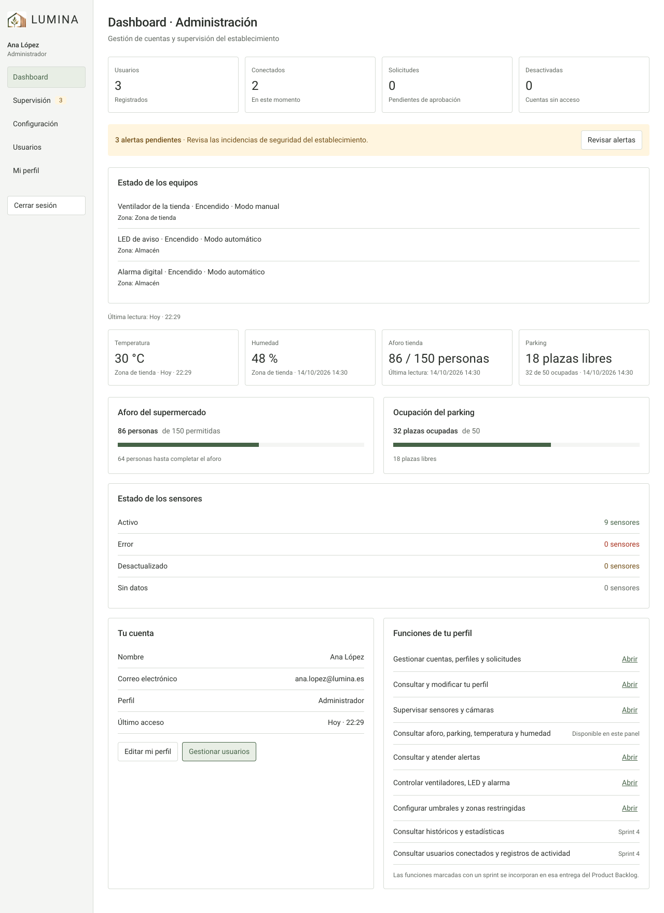
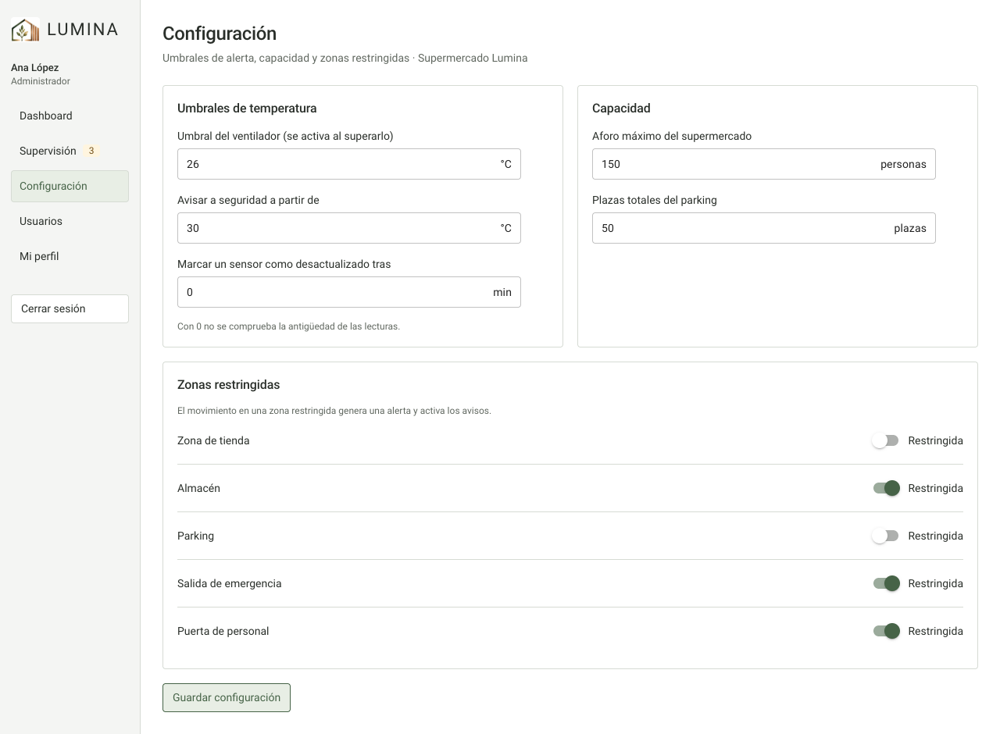
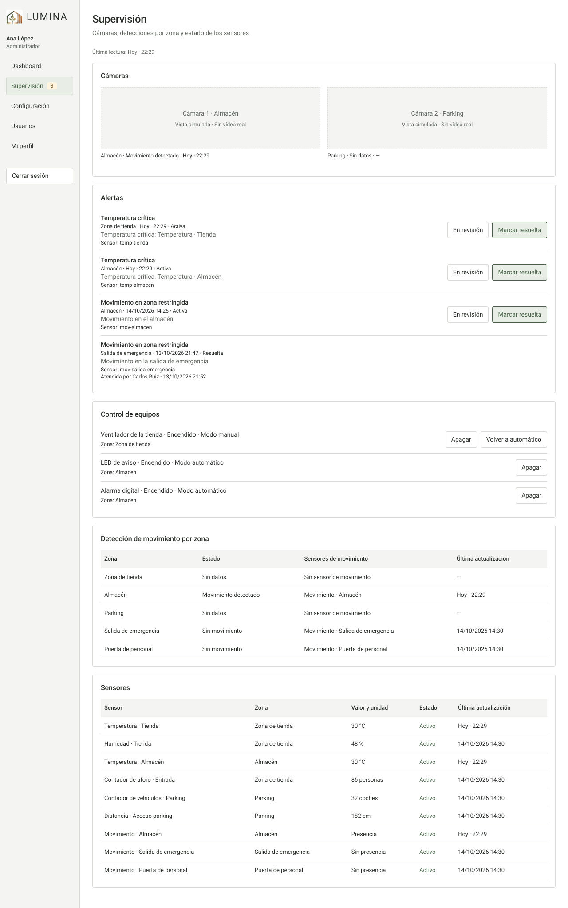
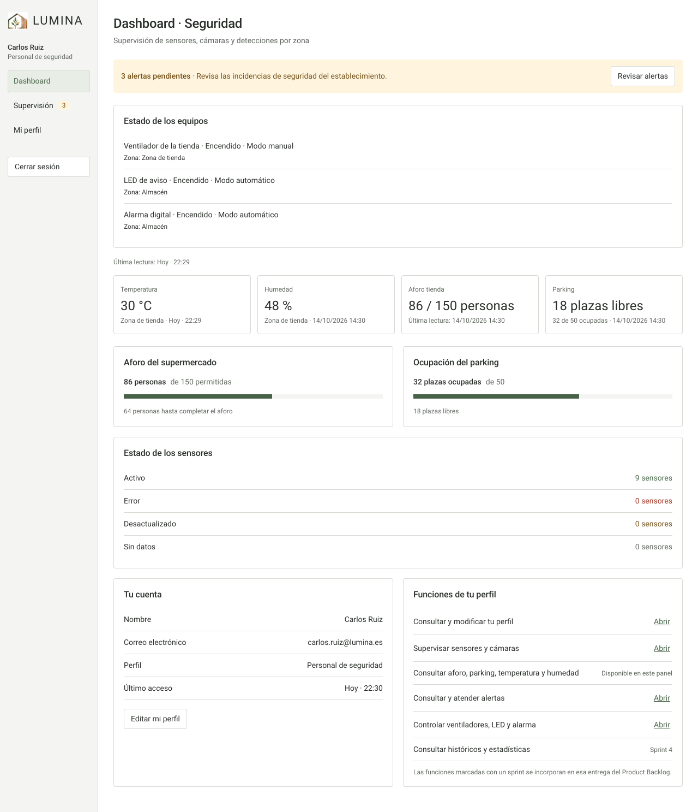
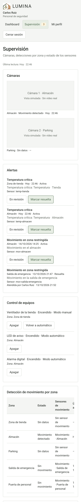
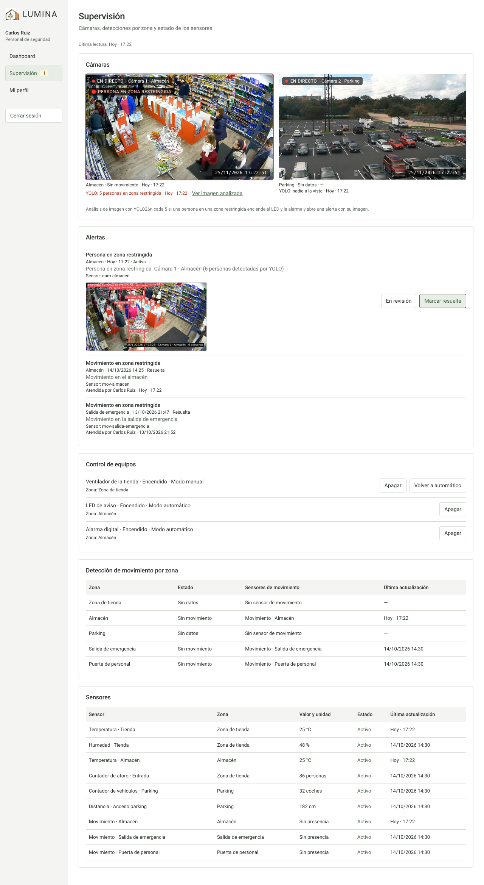
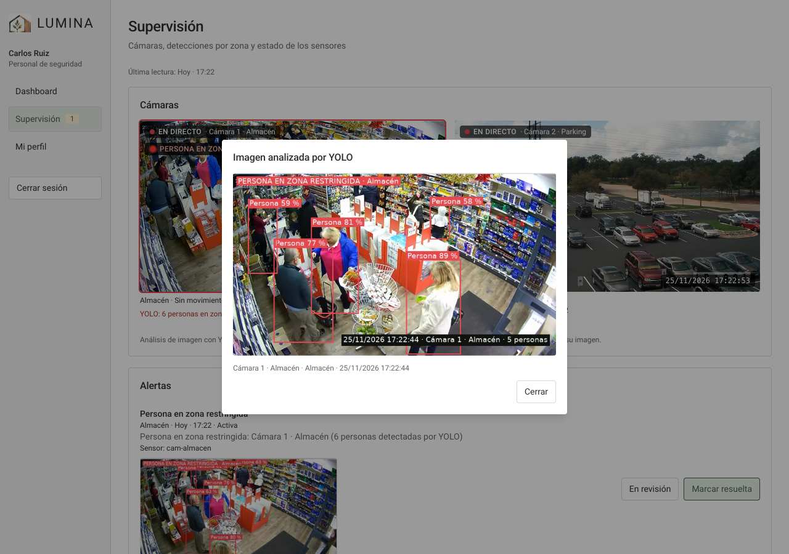

# Entrega del Sprint 3 de Lumina

Proyecto de Ingeniería Informática 1 · Universidad Europea · curso 2026-27.
**Fechas:** del 16 al 29 de noviembre de 2026, ambos incluidos.
**Planificación:** cuatro historias y 30 horas (8 + 10 + 6 + 6).

Se parte de la copia exacta del Sprint 2 y se añaden configuración, reglas automáticas,
avisos, actuadores simulados y seguimiento de incidencias. Se mantienen las funciones y
los documentos anteriores, incluido el bloqueo tras tres contraseñas incorrectas seguidas
que se añadió al Sprint 1 el 29/10/2026. Históricos, estadísticas y registros pertenecen al Sprint 4.
El 04/11/2026 se incorporaron, igual que en el Sprint 2, superadministrador, cámaras con vídeo
real y datos en vivo; se describen en
[su apartado](#ampliación-del-04112026-superadministrador-cámaras-con-vídeo-y-datos-en-vivo).
El 18/11/2026 se añadió el análisis de imagen con YOLO: una persona vista en la cámara de una zona
restringida enciende el LED y la alarma y abre una alerta con la imagen
([su apartado](#ampliación-del-18112026-análisis-de-imagen-con-yolo)). En la revisión del 25/11/2026
se corrigieron las tildes de las imágenes marcadas y un error del registro al cerrar la página con
un diálogo abierto, y se añadieron las capturas de YOLO.

## Trazabilidad con el Product Backlog

Los criterios entre comillas son literales. Todas las funciones de prueba citadas existen;
los casos parametrizados cubren varios valores, perfiles o acciones.

| Historia | Responsable | Horas | Criterio de aceptación literal | Dónde está implementado | Tests que lo prueban |
| --- | --- | ---: | --- | --- | --- |
| **H3.1 · RF-08 · Importante** | Laura Poveda | 8 | «El administrador guarda cambios válidos en JSON; las reglas posteriores usan la configuración actual.» | [configuration.py](../lumina/controllers/configuration.py), [ConfigurationPage](../lumina/views/pages/configuration.py), [RulesController](../lumina/controllers/rules.py), `ConfigRepository.modify`. | En [test_sprint3.py](../tests/test_sprint3.py): `test_configuration_saves_valid_changes_and_immediately_uses_them`, `test_configuration_rejects_invalid_changes_without_writing`, `test_configuration_validates_temperatures_after_rounding`, `test_rules_reread_thresholds_and_restricted_zones`, `test_configuration_strict_read_does_not_overwrite_corruption`. En [test_sprint3_ui.py](../tests/test_sprint3_ui.py): `test_admin_configuration_form_saves_and_rules_apply`, `test_invalid_configuration_stays_unsaved`, `test_configuration_route_is_admin_only`, `test_configuration_live_data_refreshes_external_changes`. |
| **H3.2 · RF-09 · Importante** | Ignacio Torres | 10 | «Temperatura crítica o movimiento restringido generan alerta con hora y zona; LED y alarma cambian su estado al accionarlos.» | [rules.py](../lumina/controllers/rules.py), [supervision.py](../lumina/controllers/supervision.py), [incidents.py](../lumina/views/components/incidents.py), `AlertWatcher` en [shell.py](../lumina/views/components/shell.py). | En `test_sprint3.py`: `test_simultaneous_evaluations_use_atomic_add_check`, `test_rules_do_not_duplicate_open_alerts`, `test_alert_deduplication_key_includes_type_zone_and_sensor`, `test_sensor_error_with_no_value_generates_failure`, `test_restricted_motion_activates_led_alarm_even_with_existing_alert`. En `test_sprint3_ui.py`: `test_server_rules_timer_refreshes_dashboard_and_notifies_security`, `test_alert_details_review_resolution_and_equipment_controls`, `test_alert_watcher_stops_after_permission_is_revoked`. |
| **H3.3 · RF-10 · Importante** | Ignacio Torres | 6 | «Al superar el umbral se activa el ventilador simulado; un usuario con permiso puede cambiar su estado y ver el resultado.» | `RulesController`, `SupervisionController.set_actuator` / `set_automatic`, `EquipmentPanel`. | En `test_sprint3.py`: `test_automatic_fan_hysteresis_and_manual_override`, `test_fan_uses_hottest_operational_sensor_in_its_zone`, `test_invalid_readings_do_not_drive_fan_or_motion`, `test_manager_cannot_use_any_control`. En `test_sprint3_ui.py`: `test_alert_details_review_resolution_and_equipment_controls`, `test_manager_can_consult_equipment_but_sees_no_controls`, `test_server_rules_timer_refreshes_dashboard_and_notifies_security`. |
| **H3.4 · RF-11 · Importante** | Víctor Rodríguez | 6 | «Una alerta cambia de estado al revisarla; se conservan tipo, zona, fecha y usuario responsable del cambio.» | `SupervisionController.update_alert`, `ZoneAlert`, `AlertList` en Supervisión. | En `test_sprint3.py`: `test_alert_changes_keep_original_details_and_current_responsible`, `test_alert_uses_current_responsible_name`, `test_permissions_are_checked_again_inside_transaction`, `test_old_actor_cannot_act_after_losing_access`. En `test_sprint3_ui.py`: `test_alert_details_review_resolution_and_equipment_controls`. |

`test_sprint_three_writes_follow_schemas` comprueba los cinco escenarios del simulador y
las escrituras de configuración, reglas, controles y seguimiento contra `schemas/`.
`test_alert_and_actuator_changes_never_overwrite_corrupt_files` y
`test_rules_refuse_invalid_current_configuration_without_side_effects` cubren la lectura
estricta antes de escribir. `test_configuration_action_revalidates_permissions` cubre una
página que ya estaba abierta cuando se retira el permiso. Se conservan las regresiones de
los Sprints 1 y 2; sus expectativas de nombre, disponibilidad y módulos entregados se adaptan.

## Tareas del anteproyecto

- [x] **3.1.1 · Formulario para que el Administrador fije la temperatura máxima.**
  `/configuracion`, crítica mayor que umbral tras redondear a una décima, temperaturas
  finitas de −10 a 60 °C, aforo entero 1–10 000, parking entero 1–5 000 y vigencia entera
  0–1440 minutos. Cero desactiva la comprobación de antigüedad.
- [x] **3.1.2 · Interruptores para marcar zonas como restringidas.** Se guardan los
  identificadores vigentes, conservando nombres, zona principal y campos ajenos al formulario.
- [x] **3.2.1 · Aviso en pantalla al superar el límite o detectar movimiento restringido.**
  El servidor crea la alerta; `AlertWatcher` avisa a quien tenga `MANAGE_ALERTS`, mantiene
  el contador del menú y deja de consultar si pierde el permiso. El dashboard muestra las
  incidencias abiertas. La crítica incluye la igualdad, según el requisito del motor.
- [x] **3.2.2 · Encender/apagar el LED y la alarma digital.** Controles autorizados en
  Supervisión; estado y modo persistidos. El movimiento restringido activa ambos en automático.
- [x] **3.3.1 · Controles manuales de ventiladores y activación automática.** Seguridad y
  administración; modo manual respetado y botón «Volver a automático» con evaluación inmediata.
- [x] **3.3.2 · Mostrar el estado encendido/apagado.** En Supervisión y en el dashboard
  de todos los perfiles, con modo manual/automático; gerencia solo consulta.
- [x] **3.4.1 · Listado de incidencias con fecha, tipo, zona y estado.** Sección Alertas de
  `/supervision`, con descripción, sensor, responsable y momento de la última atención.
- [x] **3.4.2 · Botones «En revisión» y «Marcar resuelta».** Cambio atómico, sin reabrir
  resueltas y sin borrar las incidencias anteriores.

## Guion de demostración en seis pasos

Las siguientes órdenes son para una demostración **manual posterior**. No se ha arrancado
la aplicación nativa ni se han abierto ventanas durante la implementación o las pruebas.
El análisis de imagen con YOLO tiene su propio paso, después del sexto
([guion](#demostración-del-análisis-de-imagen)).
Desde `lumina-sprint3`, preparar una carpeta nueva de demostración:

```bash
cp -R data /tmp/lumina-sprint3-demo
../lumina-sprint1/.venv/bin/python scripts/simular_sensores.py --datos /tmp/lumina-sprint3-demo --escenario normal
LUMINA_SIMULATION=false LUMINA_DATA_DIR=/tmp/lumina-sprint3-demo LUMINA_REFRESH_SECONDS=1 ../lumina-sprint1/.venv/bin/python main.py
```

Si ya existe esa copia, usar otra ruta nueva. Aplicación y simulador deben compartir la
carpeta de datos. Las cuentas son Ana (`ana.lopez@lumina.es`, `admin123`), Carlos
(`carlos.ruiz@lumina.es`, `seguridad123`) y Marta (`marta.garcia@lumina.es`, `gerente123`);
además, Elena (`elena.navarro@lumina.es`, `superadmin123`) es la superadministradora y Javier
(`javier.moreno@lumina.es`, `admin123`) un segundo administrador.
Los datos de ejemplo conservan su fecha original; los escenarios renuevan las lecturas.
`LUMINA_SIMULATION=false` desactiva los datos en vivo para que cada paso sea determinista. Para
enseñarlos, arrancar sin esa variable: los valores y sus horas cambian en cada refresco, las
cámaras muestran el vídeo en directo y, de vez en cuando, una detección simulada en una zona
restringida abre una alerta. Los escenarios siguen mandando sobre la simulación durante dos
minutos desde su última escritura.

1. **Configuración y validación.** Entrar como Ana y abrir Configuración. Guardar umbral
   **26 °C**, crítica **30 °C**, aforo **150**, plazas **50**, vigencia **0** y Almacén
   restringido. Intentar crítica **25 °C**: se rechaza sin guardar. Restaurar 30 °C.
   Mostrar que los cambios válidos están en `configuracion.json` y se aplican al guardar.
2. **Preparar la ventilación automática.** En Supervisión se ve la alerta inicial de almacén
   y el ventilador manual. Marcar esa alerta «En revisión» y «Marcar resuelta»; comprobar
   responsable y fecha. Como el escenario normal dejó el movimiento a cero, no reaparece.
   Apagar LED y alarma. Pulsar «Volver a automático» en el ventilador: queda apagado porque
   los sensores están a 25 °C. Cerrar sesión y **esperar a «Iniciar sesión»**; entrar con Carlos.
3. **Calor, crítica y control manual.** En otra terminal ejecutar, de una en una:

   ```bash
   ../lumina-sprint1/.venv/bin/python scripts/simular_sensores.py --datos /tmp/lumina-sprint3-demo --escenario calor
   ../lumina-sprint1/.venv/bin/python scripts/simular_sensores.py --datos /tmp/lumina-sprint3-demo --escenario critica
   ```

   Tras `calor`, esperar el ciclo del servidor: 27 °C enciende el ventilador. Tras `critica`,
   30 °C genera alertas con zona, sensor y hora; aparecen avisos y el contador aumenta.
   Hay dos sensores de temperatura, por lo que puede haber una alerta por cada uno.
   Esperar varios ciclos: no se duplican. Apagar manualmente el ventilador y esperar:
   sigue apagado en modo manual. «Volver a automático» lo enciende de inmediato.
   Ejecutar `--escenario normal`: a 25 °C se apaga. Explicar la histéresis de 0,5 °C,
   comprobada en tests en los límites 26; 25,6; 25,5 y 26,1 °C.
4. **Movimiento y zonas restringidas.** Ejecutar:

   ```bash
   ../lumina-sprint1/.venv/bin/python scripts/simular_sensores.py --datos /tmp/lumina-sprint3-demo --escenario movimiento
   ```

   Aparece una nueva alerta de almacén; LED y alarma quedan encendidos en modo automático.
   Apagar la alarma mientras persiste el movimiento: el próximo ciclo la reactiva.
   Volver con Ana, desmarcar Almacén como restringido y guardar. Resolver su alerta y
   apagar los avisos: los ciclos posteriores no generan otra alerta de movimiento en esa
   zona. Volver a restringirla y guardar: con movimiento positivo aparece una alerta nueva
   inmediatamente. La configuración no borra las incidencias anteriores.
5. **Seguimiento y fallo.** Con Carlos, marcar la alerta nueva «En revisión»: se conserva
   tipo, zona y fecha y aparece «Atendida por Carlos Ruiz». Ejecutar `--escenario normal`
   para retirar la condición y después resolverla. Apagar los avisos si procede. Ejecutar
   `--escenario fallo`: aparecen alertas de fallo de sensor. Ejecutar `--escenario normal`
   para restablecer las temperaturas y resolver sus incidencias. La resolución no borra
   datos ni apaga equipos automáticamente; si persiste la causa, puede generarse otra alerta.
6. **Permisos y regresiones.** Cerrar sesión, esperar al login y entrar con Marta. Mostrar
   aforo, parking, ambiente y estado de equipos sin botones «Encender», «Apagar» ni
   «Volver a automático». No tiene configuración, avisos ni supervisión; las rutas directas
   se rechazan. Volver con Ana para comprobar usuarios, perfil y desbloqueo de cuentas conservados
   (las filas de Javier y Elena no tienen controles: solo las gestiona el superadministrador), entrar
   con Elena para cambiar el perfil de un administrador o desactivarlo, y con Carlos para mostrar
   sensores, cámaras con vídeo y detecciones del Sprint 2. Cerrar sesión al terminar.

`--escenario` escribe una sola vez y termina; no arranca la interfaz ni llama al motor.
El modo aleatorio del Sprint 2 sigue funcionando con `--intervalo`, `--semilla`,
`--movimiento` y `--ciclos`. Los escenarios usan los umbrales vigentes y restablecen
explícitamente las lecturas necesarias para poder repetir la demostración tras un fallo.

Capturas del Sprint 3. Las cinco primeras (datos de ejemplo con los escenarios `critica` y
`movimiento` del simulador) se tomaron antes de la ampliación del 04/11/2026 y muestran las cámaras
simuladas. Las dos de YOLO se tomaron el 25/11/2026 con el análisis en vivo, partiendo del escenario
`normal`, sin alertas abiertas y con el LED y la alarma apagados:

| Pantalla | Captura |
| -------- | ------- |
| Dashboard de administración: aviso de alertas y estado de los equipos |  |
| Configuración: umbrales, capacidad y zonas restringidas |  |
| Supervisión: alertas, control de equipos, detecciones y sensores |  |
| Dashboard de seguridad |  |
| Supervisión en el móvil |  |
| YOLO: personas en el almacén (zona restringida), piloto rojo, alerta con la imagen y LED y alarma encendidos en automático |  |
| YOLO: imagen analizada, con las personas recuadradas |  |

Las capturas de los sprints anteriores están en [capturas/sprint-2/](capturas/sprint-2/) y en [capturas/](capturas/) (Sprint 1).

## Definición de hecho

- [x] Cuatro criterios literales implementados y vinculados a pruebas.
- [x] MVC, controladores sin NiceGUI, pantallas como clases protegidas y componentes reutilizables.
- [x] Interfaz solo en Python y estilos con `Theme` / `Palette`; sin inyección HTML/JS/CSS.
- [x] Lectura estricta y escritura atómica en configuración, alertas y equipos; autorización
  revalidada dentro de `modify` y deduplicación dentro de `add(check=...)`.
- [x] Un temporizador de reglas del servidor, independiente del número de páginas/clientes;
  intervalo 0 desactiva reglas periódicas y refrescos. Las acciones explícitas siguen operativas.
- [x] Histéresis, modo manual y retorno a automático comprobados con `FixedClock`.
- [x] Alertas sin duplicados, incluso con dos repositorios evaluando simultáneamente en hilos.
- [x] Estados Activa / En revisión / Resuelta y responsable conservado en `alertas.json`.
- [x] Dashboard con avisos autorizados, estado de equipos y `CURRENT_SPRINT = 3`.
- [x] Contratos JSON conservados, descripciones actualizadas y documentación regenerada.
- [x] README, arquitectura y UML actualizados; documentos anteriores conservados.
- [x] `APP_EDITION = 'Lumina Sprint 3'`, identificador `es.lumina.sprint3` y pruebas adaptadas.
- [x] Python 3.13 / NiceGUI 3.18, manteniendo compatibilidad ≥ 3.11 y sin PEP 695.
- [x] pytest, mypy estricto y ruff comprobados sin ventanas ni navegadores.

Comandos de verificación desde esta carpeta:

```bash
../lumina-sprint1/.venv/bin/python -m pytest -q -p no:cacheprovider
../lumina-sprint1/.venv/bin/mypy
../lumina-sprint1/.venv/bin/ruff check .
```

Resultado final tras la revisión del 25/11/2026: **439 tests superados**, mypy estricto sin
errores en **79 ficheros** y ruff sin incidencias, con el entorno propio de la entrega (`.venv`:
YOLO real, PyTorch, OpenCV y NiceGUI 3.19). Con el entorno del Sprint 1 (NiceGUI 3.18, sin YOLO),
435 superados y 4 omitidos, los que necesitan YOLO u OpenCV de verdad. La revisión añadió 3 tests
a los 436 de la ampliación del 18/11/2026. Antes de esa ampliación: 388 tests y 73 ficheros (y antes del 04/11/2026, 353 tests y 71 ficheros: 340 de la entrega y 13
del bloqueo por intentos fallidos añadido al Sprint 1). La batería conserva las pruebas anteriores,
adapta las expectativas de nombre y funcionalidades entregadas y cubre controladores,
interfaz, los nuevos módulos y la ruta protegida.

```bash
.venv/bin/python -m pytest -q -p no:cacheprovider   # entorno propio, con YOLO
.venv/bin/mypy
.venv/bin/ruff check .
```

### Auditoría y regresiones

Se comparó la entrega con Sprint 2 y se corrigieron cinco hallazgos confirmados; las filas con
fecha son de revisiones posteriores:

| Gravedad | Escenario y corrección | Prueba de regresión |
| --- | --- | --- |
| Alta | La E/S de reglas bloqueaba el bucle de eventos. El ciclo y las acciones que evalúan reglas trabajan en un hilo; el cierre cancela el temporizador y espera la evaluación en curso. | `test_rules_timer_does_not_block_event_loop_and_waits_on_shutdown`, `test_rules_timer_retries_after_unexpected_exception`, `test_rule_actions_run_outside_event_loop`. |
| Alta | Umbrales externos no finitos, fuera de rango o incoherentes alteraban o desactivaban las reglas. Se rechazan al leer configuración, antes de escribir alertas o equipos. | `test_rules_reject_malformed_thresholds_without_side_effects`. |
| Media | Una lectura no finita se mostraba como Error, pero no generaba fallo de sensor. Se usa también ese estado efectivo para crear la alerta. | `test_nonfinite_sensor_generates_failure_without_driving_fan`. |
| Media | El refresco externo borraba el borrador del administrador. Se conserva mientras haya ediciones pendientes, incluidas las realizadas durante un guardado. | `test_configuration_poll_preserves_unsaved_numbers_and_switches`, `test_configuration_keeps_edits_made_while_save_is_running`. |
| Media | Un JSON inicial de alertas o configuración dañado impedía construir la página desde el menú. Se permite construirla y el observador reintenta sin notificar como nuevas las alertas anteriores. | `test_shell_recovers_from_initial_malformed_alert_data`. |
| Media | *Revisión del 18/11/2026.* Con NiceGUI 3.19 (la versión que instala hoy `requirements.txt`), si Supervisión o Configuración se redibujaban mientras «Volver a automático» o «Guardar configuración» trabajaban en su hilo, el aviso final fallaba («The parent element this slot belongs to has been deleted») y no se releían los datos. NiceGUI 3.18 lo ocultaba en los tests. `ProtectedPage.act_async` muestra ahora los avisos y relee los datos (`then=`) en la página, no en el botón pulsado. | `test_async_actions_survive_a_refresh_while_they_run` y, con NiceGUI 3.19, `test_alert_details_review_resolution_and_equipment_controls`. |
| Media | *Revisión del 25/11/2026.* La fuente que trae Pillow no tiene tildes ni eñes: en las imágenes marcadas por YOLO, también las de las alertas, «Almacén» y «Cámara» salían «Almac□n» y «C□mara». `CapturePainter.font` usa DejaVu Sans (llega con matplotlib al instalar ultralytics) o una fuente del sistema con tildes; la de Pillow queda como último recurso. | `test_the_marked_image_writes_accents_and_enes`. |
| Baja | *Revisión del 25/11/2026.* Desde NiceGUI 3.16, al cerrar la pestaña con un diálogo abierto (imagen analizada, editar usuario o contraseña temporal) NiceGUI lo borra y termina su espera; el `dialog.delete()` posterior dejaba un `ValueError` en el registro. Ahora solo se borra si sigue existiendo. | `test_closing_the_page_with_the_analyzed_image_open_leaves_no_error`, `test_closing_the_page_with_a_dialog_open_leaves_no_error`. |

También se amplió la cobertura de transacciones reentrantes de configuración entre
repositorios de la misma ruta, de revisión/resolución simultánea y del enclavamiento de
LED y alarma al cesar el movimiento o quitar la restricción de la zona. Se conserva la
limitación documentada de los bloqueos al mismo proceso: el lanzador impide dos instancias
de Lumina por carpeta; un escritor externo no participa en sus transacciones. No se han
cambiado campos JSON ni los datos de ejemplo, ni abierto ventanas o ejecutado PyInstaller.

## Ampliación del 04/11/2026: superadministrador, cámaras con vídeo y datos en vivo

Las mismas tres mejoras del Sprint 2, integradas con la configuración, las reglas y las alertas del Sprint 3:

| Mejora | Qué se ha hecho | Dónde | Tests |
| --- | --- | --- | --- |
| **Superadministrador** | Nuevo perfil `superadmin` («Superadministrador») con todos los permisos, incluido el nuevo `gestionar_administradores`. Jerarquía: cada cuenta solo gestiona cuentas, y asigna perfiles, de rango inferior. **Los administradores no se pueden modificar entre sí** ni dar de alta o ascender administradores; el superadministrador gestiona sus perfiles y permisos, sus datos, su activación («cerrar la cuenta») y su desbloqueo. Nadie modifica ni asigna el perfil de superadministrador desde la aplicación. Se comprueba en el controlador, con las cuentas vigentes y dentro de la transacción; «Usuarios» solo muestra controles en las filas gestionables y el aviso de cuentas bloqueadas solo cuenta las que quien mira puede desbloquear. | [enums.py](../lumina/models/enums.py) (`Role.can_manage`, `assignable_roles`), [entities.py](../lumina/models/entities.py) (`User.can_manage`), [users.py](../lumina/controllers/users.py), [pages/users.py](../lumina/views/pages/users.py), [pages/dashboard.py](../lumina/views/pages/dashboard.py), [usuarios.json](../data/usuarios.json) | En [test_controllers.py](../tests/test_controllers.py): `test_admins_cannot_modify_other_admins`, `test_nobody_modifies_the_superadmin_from_the_list`, `test_only_the_superadmin_grants_the_admin_role`, `test_the_superadmin_role_is_never_assigned`, `test_the_superadmin_manages_admin_accounts`, `test_the_hierarchy_uses_the_current_accounts`, `test_two_superadmins_cannot_modify_each_other`, `test_counts_only_warn_about_accounts_the_viewer_can_unlock`. En [test_ui.py](../tests/test_ui.py): `test_admins_see_other_admins_without_being_able_to_touch_them`, `test_the_superadmin_manages_admin_accounts_and_permissions`. |
| **Cámaras funcionales** | Cada cámara reproduce en bucle, sin sonido ni controles, un vídeo real de videovigilancia: el interior de una tienda para la cámara 1 y un aparcamiento para la cámara 2 (grabaciones de dominio público en Wikimedia Commons). Rótulo «EN DIRECTO», hora sobreimpresa que avanza cada segundo y aviso «Sin señal de vídeo» si no se puede reproducir. Los refrescos solo cambian los rótulos: el vídeo no se reinicia. *Desde el 18/11/2026 las cámaras de ejemplo usan copias locales de esos vídeos (`assets/camaras/`), porque Wikimedia rechaza que la aplicación los descargue para analizarlos con YOLO.* | [components/camera.py](../lumina/views/components/camera.py), [pages/supervision.py](../lumina/views/pages/supervision.py), [sensores.json](../data/sensores.json) › `camaras[].url` | En [test_supervision_ui.py](../tests/test_supervision_ui.py): `test_cameras_play_a_supermarket_surveillance_video`, `test_refreshes_update_camera_captions_without_restarting_the_video`, `test_a_camera_that_loses_its_signal_says_so`, `test_the_camera_clock_ticks_every_second`, `test_a_camera_without_url_keeps_the_simulated_view`. |
| **Datos en vivo** | `LiveSimulator` genera lecturas verosímiles en cada refresco dentro de la propia aplicación: temperatura y humedad con ciclo diario, aforo y parking según la afluencia de cada hora, coches en el acceso y detecciones esporádicas, todas con su hora actual. Respeta los sensores sin lectura, en error o desactualizados y cede el control a cualquier otra fuente (maqueta IoT o simulador de terminal) durante dos minutos desde su última escritura. Se ejecuta en un hilo mediante `BackgroundCycle`; `LUMINA_SIMULATION=false` la desactiva. | [controllers/simulation.py](../lumina/controllers/simulation.py), [app.py](../lumina/app.py) (`BackgroundCycle`), [settings.py](../lumina/settings.py) | [test_live_simulation.py](../tests/test_live_simulation.py) (13 casos, entre ellos `test_demo_scenarios_keep_priority_over_the_live_simulation` y `test_live_motion_in_a_restricted_zone_raises_a_single_alert`) y, en [test_supervision_ui.py](../tests/test_supervision_ui.py), `test_the_live_simulation_refreshes_the_screens_by_itself`. |

Fuentes de vídeo (dominio público; se pueden sustituir por la URL de cualquier cámara en
`sensores.json`): [HD CCTV Camera video · retail store](https://commons.wikimedia.org/wiki/File:HD_CCTV_Camera_video_3MP_4MP_iProx_CCTV_HDCCTVCameras.net_retail_store.webm)
y [BLK-HDPTZ12 Security Camera Parking Lot Surveillance Video](https://commons.wikimedia.org/wiki/File:BLK-HDPTZ12_Security_Camera_Parking_Lot_Surveillance_Video.webm).
Se usa su versión de 480p en WebM (VP9), compatible con la ventana de escritorio en macOS,
Windows y Linux. Desde el 18/11/2026 esas mismas versiones están en `assets/camaras/` (11,7 y
18,2 MB) y `sensores.json` apunta a ellas (`/assets/camaras/tienda.webm` y `parking.webm`).

Integración con el Sprint 3: las reglas evalúan las lecturas simuladas como las de la maqueta
(una detección en zona restringida abre una alerta, una sola abierta por sensor, y enciende LED y
alarma; la temperatura mueve el ventilador automático). Los escenarios del simulador de terminal
mandan sobre la simulación durante dos minutos desde su última escritura, por lo que `calor`,
`critica`, `movimiento`, `normal` y `fallo` se comportan como antes. `SupervisionPage` mantiene
alertas y equipos en el bloque que se redibuja y saca de él las cámaras.

## Ampliación del 18/11/2026: análisis de imagen con YOLO

Las cámaras dejan de ser solo una imagen: en cada refresco, YOLO busca personas en un fotograma de
cada una. Es la idea del anteproyecto (cámara que apoya la supervisión de accesos restringidos)
llevada a la regla de H3.2: **una persona vista en una zona restringida actúa como el sensor de
movimiento de esa zona**. Se enciende un piloto rojo sobre la imagen de la cámara, el LED de aviso y la
alarma de la zona pasan a encendidos en modo automático y se abre una alerta «Persona en zona
restringida» con hora, zona, cámara y la **imagen en la que se vio a la persona**, con las personas
recuadradas. En las zonas no restringidas YOLO solo cuenta las personas. Al restringir o liberar
una zona en Configuración, la regla se aplica en la evaluación siguiente.

| Pieza | Qué hace | Dónde | Tests |
| --- | --- | --- | --- |
| **Ciclo de análisis** | Un `BackgroundCycle` del servidor ejecuta `VisionController.step()` cada `LUMINA_REFRESH_SECONDS`, en un hilo. Por cada cámara activa con señal: fotograma, YOLO y resultado guardado en la cámara (`personas`, `analizada_en`, `captura`). Sin imagen no supone a nadie (`personas: null`). Un análisis escrito por otro programa manda durante dos minutos. Si no puede cargar YOLO, lo indica y reintenta al minuto. | [vision.py](../lumina/controllers/vision.py), [app.py](../lumina/app.py) | En [test_vision.py](../tests/test_vision.py): `test_each_cycle_counts_people_and_keeps_the_marked_image`, `test_without_an_image_nobody_is_assumed`, `test_inactive_cameras_or_without_signal_are_not_analyzed`, `test_the_status_says_which_model_is_working_or_why_not`, `test_an_analysis_written_by_another_source_keeps_priority_for_two_minutes`. |
| **YOLO y fotogramas** | `YoloPersonDetector`: modelo preentrenado `yolo26n.pt` de ultralytics (clase *person*, confianza ≥ 50 %), descargado la primera vez en `descargas/`, sin telemetría ni instalaciones automáticas. `VideoFrameReader`: con OpenCV toma el fotograma de la hora actual, con el vídeo en bucle. Las cámaras de ejemplo pasan a usar copias locales (`assets/camaras/`, servidas en `/assets/camaras/`) de sus vídeos de Wikimedia Commons, porque Wikimedia rechaza las descargas de programas como OpenCV, urllib o httpx (HTTP 429/403); un vídeo de otro servidor se descarga una vez, en segundo plano, con httpx y sus certificados. Solo este módulo importa ultralytics y OpenCV, y al usarse. | [yolo.py](../lumina/controllers/yolo.py) | `test_real_yolo_finds_the_people_of_the_sample_photo`, `test_real_yolo_sees_the_shoppers_of_the_almacen_camera_and_the_rules_react`, `test_opencv_takes_the_frame_of_the_current_moment`, `test_the_frame_reader_uses_the_videos_served_by_the_application`, `test_internet_videos_are_downloaded_once_with_lumina_user_agent`, `test_camera_images_are_fetched_again_each_time_and_errors_mean_no_image`, `test_the_frame_reader_reads_local_images`, `test_without_ultralytics_the_analysis_is_unavailable`, `test_importing_lumina_does_not_load_yolo_or_opencv`. |
| **Regla** | `RulesController` trata el último análisis como movimiento de la zona de la cámara: en zona restringida, alerta `persona_zona_restringida` (una abierta por cámara) con su `captura`, y LED y alarma encendidos. Se aplica la misma vigencia que a los sensores y se ignoran las cámaras en error. | [rules.py](../lumina/controllers/rules.py), `FacilityAnalyzer.camera_sees_people` | `test_a_person_in_a_restricted_zone_lights_the_led_and_opens_an_alert_with_the_image`, `test_people_outside_restricted_zones_are_only_counted`, `test_restricting_a_zone_applies_to_people_already_seen`, `test_a_camera_alert_is_not_repeated_while_open`, `test_old_or_disconnected_camera_analyses_do_not_count`. |
| **Imagen marcada** | `CapturePainter` recuadra a cada persona con su confianza y rotula «PERSONA EN ZONA RESTRINGIDA» en rojo (o las personas vistas, en verde), con cámara y hora; JPEG de 960 px como máximo. Los rótulos usan una fuente con tildes y eñes (DejaVu Sans, que llega con matplotlib al instalar ultralytics, o una del sistema). `FileCaptureRepository` guarda cada imagen con un nombre nuevo en `capturas/` y borra a los dos minutos las que no usan ni las cámaras ni las alertas. | [vision.py](../lumina/controllers/vision.py), [captures.py](../lumina/repositories/captures.py) | `test_the_painter_marks_people_in_red_only_in_restricted_zones`, `test_large_frames_are_reduced_before_saving`, `test_the_marked_image_writes_accents_and_enes`, `test_old_unused_captures_are_deleted_but_alert_images_stay`, `test_capture_references_never_leave_their_folder`. |
| **Pantallas** | En Supervisión, cada cámara indica lo que ve YOLO, enciende el piloto rojo «PERSONA EN ZONA RESTRINGIDA» sobre el vídeo (que no se reinicia) y abre la imagen analizada en un diálogo; bajo las cámaras se explica el estado del análisis. Cada alerta de una cámara muestra su imagen, servida en `/capturas`. Gerencia sigue sin ver cámaras. | [camera.py](../lumina/views/components/camera.py), [incidents.py](../lumina/views/components/incidents.py), [supervision.py](../lumina/views/pages/supervision.py) | En [test_vision_ui.py](../tests/test_vision_ui.py): `test_a_person_in_a_restricted_zone_lights_the_camera_led_and_shows_the_image`, `test_the_alert_shows_the_image_where_the_person_was_seen`, `test_the_live_analysis_turns_on_the_led_and_warns_security`, `test_the_screen_explains_when_yolo_is_not_available`, `test_new_analyses_refresh_the_captions_without_restarting_the_videos`, `test_the_manager_never_sees_cameras_nor_images`, `test_closing_the_page_with_the_analyzed_image_open_leaves_no_error`. |
| **Contrato y herramientas** | Campos opcionales nuevos en `sensores.json` › `camaras` y en `alertas.json`, y el tipo `persona_zona_restringida`, documentados en los esquemas. `scripts/analizar_imagen.py` analiza una foto para una cámara. `LUMINA_VISION` y `LUMINA_YOLO_MODEL` en `AppSettings`. El ejecutable no incluye YOLO. | [schemas/](../schemas), [analizar_imagen.py](../scripts/analizar_imagen.py), [settings.py](../lumina/settings.py), [empaquetar.py](../scripts/empaquetar.py) | `test_what_the_analysis_writes_follows_the_schemas`, `test_camera_analysis_and_alert_images_round_trip_through_json`, `test_the_analysis_script_marks_the_photo_and_the_rules_open_the_alert`, `test_the_analysis_script_explains_wrong_arguments`, `test_the_analysis_can_be_configured_with_environment_variables`; casos nuevos en `test_schemas_reject_invalid_data` y en `test_empaquetar.py`. |

Decisiones:

- **Un sensor más, no un sistema aparte.** El análisis se guarda en la propia cámara, como la lectura
  de un sensor, y la regla vive junto a la del movimiento. Así la configuración de zonas restringidas,
  la deduplicación, el enclavamiento del LED y la alarma, los avisos emergentes y el seguimiento de la
  alerta (H3.4) funcionan sin cambios.
- **Toda la imagen de la cámara pertenece a su zona.** Una cámara vigila una zona; no se dibujan
  áreas restringidas dentro de la imagen.
- **YOLO26n** es el modelo preentrenado más ligero de ultralytics: unos 20 ms por fotograma en un
  portátil, sin GPU. Se puede cambiar con `LUMINA_YOLO_MODEL`.
- **Dependencia opcional en tiempo de ejecución.** ultralytics está en `requirements.txt`, pero la
  aplicación arranca igual sin él (o sin conexión para descargar el modelo) y Supervisión explica por
  qué no hay análisis. Los tests usan un detector de prueba; los de YOLO real se omiten si no está instalado.
- **Sin JavaScript.** Los recuadros se dibujan en el servidor con Pillow y la imagen se muestra con
  un ``; el piloto y el aviso son clases Tailwind de `Theme`.
- Las imágenes se sirven sin sesión en `/capturas`, como las de `assets`, con nombres aleatorios
  imposibles de adivinar; la aplicación escucha solo en el propio equipo.

### Demostración del análisis de imagen

Necesita el entorno propio de la entrega, con YOLO (`.venv`, ver el README). Con la carpeta de
demostración del guion anterior, arrancar la aplicación con ese entorno y el análisis en vivo
desactivado, para que sea determinista:

```bash
LUMINA_SIMULATION=false LUMINA_VISION=false LUMINA_DATA_DIR=/tmp/lumina-sprint3-demo LUMINA_REFRESH_SECONDS=1 .venv/bin/python main.py
```

Entrar con Carlos, ejecutar `--escenario normal`, resolver la alerta del almacén y apagar LED y
alarma. Después, en otra terminal:

```bash
.venv/bin/python scripts/analizar_imagen.py --datos /tmp/lumina-sprint3-demo --camara cam-almacen --ejemplo
```

En el siguiente ciclo aparece el aviso «Nueva alerta: Persona en zona restringida · Almacén», el LED
y la alarma se encienden y, en Supervisión, la cámara del almacén muestra el piloto rojo, «YOLO: 4
personas en zona restringida» y «Ver imagen analizada». La alerta incluye la foto con las cuatro
personas recuadradas en rojo. Repetir con `--camara cam-parking`: el parking no es restringido, así
que solo se cuentan las personas, en verde. Para verlo en vivo, arrancar sin `LUMINA_VISION=false`:
YOLO analiza los vídeos de las cámaras cada pocos segundos y la cámara del almacén, que muestra el
interior de una tienda con clientes, enciende el piloto y abre la alerta en el primer ciclo. Si se
marca el almacén como no restringido en Configuración, deja de hacerlo.

## Decisiones de implementación

- **Ubicación del listado.** Sección completa de `/supervision`, con detalle en cada fila;
  no se añade `/alertas`. Las funciones del dashboard enlazan a Supervisión y Configuración.
- **Compatibilidad de estados.** «Activa» en pantalla conserva `pendiente` en JSON.
  Pendiente y en revisión son abiertas; solo se admiten cambios a revisión o resolución.
  Repetir el estado actual no cambia responsable ni fecha. Una resuelta no se reabre:
  si persiste la causa, las reglas crean otra incidencia con identificador y hora nuevos.
- **Responsable.** Se guarda el nombre vigente de quien realiza el último cambio efectivo
  en `atendida_por`, y su momento en `actualizada_en`. No hay un registro de actividad ni
  un historial de cada transición, que pertenecen al Sprint 4.
- **Reglas y sensores.** Se relee estrictamente la configuración en cada evaluación.
  Se rechazan umbrales no finitos, fuera de −10–60 °C o con crítica menor o igual al umbral.
  Solo las lecturas operativas generan movimiento/temperatura; un error explícito genera
  fallo aunque no tenga valor, y una lectura no finita también genera fallo. Se usa la temperatura máxima operativa de cada zona para
  ventilación, sin confundirla con la media ambiental del dashboard. Una alerta conserva
  tipo, zona, sensor y hora de evaluación. La clave de deduplicación es tipo + zona + sensor.
- **Ventilador.** Encendido con `temperatura > umbral`, apagado con
  `temperatura <= umbral − 0,5 °C`; en la banda o sin lectura válida mantiene el estado.
  Un control manual cambia el modo incluso si el estado ya coincidía. El estado inicial
  manual de los datos del Sprint 2 se conserva; no se cambia sin acción del usuario.
- **LED y alarma.** El movimiento restringido activa los equipos de esa zona en automático,
  incluso si ya existía una alerta abierta. No se apagan solos. Apagarlos manualmente solo
  dura hasta el próximo ciclo si persiste el movimiento. No se añaden equipos inexistentes.
- **Ciclo del servidor.** `LuminaApp` registra un único `app.timer`, con el mismo intervalo
  que `LiveData` y `AlertWatcher`. La evaluación se ejecuta en un hilo y cualquier excepción
  se registra para permitir el siguiente ciclo. El cierre cancela el temporizador y espera
  la evaluación en curso. Las acciones de guardar configuración y volver a automático usan
  `ProtectedPage.act_async()`, que revalida la sesión y también ejecuta la E/S en un hilo.
  No se escribe ningún fichero de actividad.
- **Atomicidad.** Cada entidad/documento tiene su transacción. Los repositorios JSON del
  mismo proceso comparten un cerrojo por ruta, también cuando se crean independientemente.
  No hay transacción conjunta de configuración, sensores, alertas y actuadores, ni bloqueo
  entre procesos externos. Si guardar configuración se completa y una escritura posterior
  de reglas falla, la configuración permanece guardada y se informa del error; el ciclo
  siguiente reintenta las reglas. Con intervalo 0, corregir los datos y volver a guardar.
- **Interfaz actualizable.** `self.live(...)` refresca configuración, equipos y alertas.
  Un cambio externo de configuración reconstruye el formulario si no tiene ediciones
  pendientes; en caso contrario conserva el borrador, también durante un guardado.
  El aviso emergente solo anuncia alertas que aparecen después de abrir la página;
  las ya existentes están en el contador, el dashboard y el listado. Si el menú no pudo
  leer las alertas al abrir, el observador reintenta y usa su primera lectura válida como
  referencia, sin impedir construir la página ni anunciar como nuevas las alertas anteriores.

## Fuera de alcance

| Entrega | Funciones que no se añaden |
| --- | --- |
| **Sprint 4** | Históricos y estadísticas, registros de actividad, validación final y ajustes responsive. |
| **Fase 2** | Maqueta física, sensores/actuadores reales y base de datos en servidor. |

Los contratos previos de históricos se conservan, sin consultarlos ni escribirlos desde
las funciones del Sprint 3. No se añaden `ActivityLog`, `registros.json` ni sus pantallas.
El ejecutable `dist/Lumina Sprint 3.app` se ha construido con `scripts/empaquetar.py` y probado: abre su ventana, inicia sesión y al cerrarla no deja sesiones abiertas. Se regeneró el 31/10/2026 con el bloqueo por intentos fallidos y se repitió la comprobación, añadiendo el bloqueo y el desbloqueo de una cuenta. Es anterior a las ampliaciones del 04/11/2026 y del 18/11/2026: hay que regenerarlo con `scripts/empaquetar.py` para incluirlas (sin YOLO, que el ejecutable no lleva).
