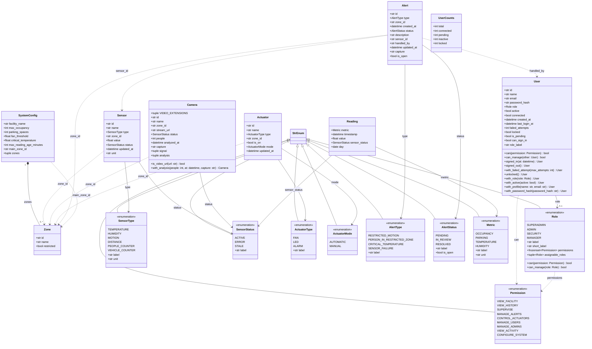
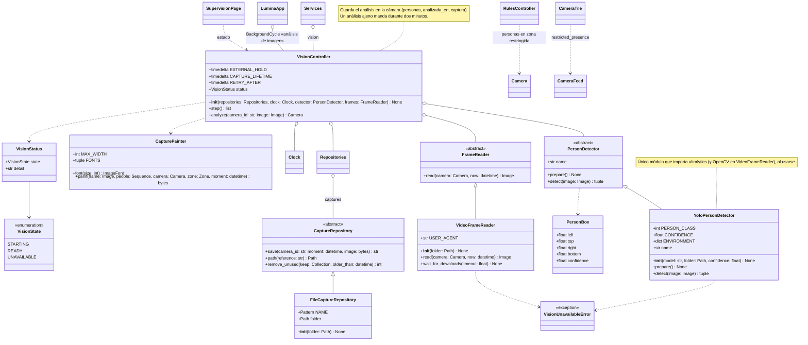

# Diagrama de clases UML de Lumina (H1.1 · tarea 1.1.1)

Los diagramas describen las clases existentes en `lumina/` en esta entrega del Sprint 3,
incluidas las protecciones del Sprint 1. El apartado d) amplía los tres diagramas originales
con la supervisión y las herramientas del Sprint 2; el apartado e) añade configuración,
reglas, alertas y equipos del Sprint 3, y el f), el análisis de imagen con YOLO (18/11/2026).
No representa funciones futuras.
La arquitectura por capas está en [arquitectura.md](arquitectura.md) y el contrato de los ficheros
en [esquemas-json.md](esquemas-json.md).

Convenciones de lectura:

- `+` indica atributos, propiedades de lectura y métodos públicos. Se incluyen los constructores
  explícitos `__init__`; los constructores generados de las dataclasses se deducen de sus campos.
  Se omiten los miembros privados, los métodos especiales generados y los métodos públicos
  heredados de bibliotecas externas. Los miembros heredados de Lumina se leen en la clase base.
- Una flecha continua con triángulo representa herencia; un rombo lleno, composición; un rombo
  vacío, una referencia compartida o inyectada; una flecha discontinua, dependencia. Las referencias
  por identificador se señalan expresamente y no implican que se almacene el objeto relacionado.
- Para facilitar el renderizado de Mermaid en GitHub se omite la unión con `None` en los tipos,
  se usan genéricos con `~` y se abrevian las anotaciones de `Callable`, `dict`, `tuple`, `Mapping`, `MutableMapping`
  y `type`. Los parámetros por nombre y los valores por defecto se consultan en los ficheros fuente;
  `DataTable.add_row` recibe `*values`. Estas abreviaturas no añaden clases ni cambian los contratos.
- Las dataclasses de dominio, `UserCounts`, `Repositories`, `Services`, `NewUserCredentials`,
  `ViewContext`, `NavItem`, `RoleFeature`, `Tone` y `AppSettings` son inmutables (`frozen=True`).
  Los símbolos sin miembros que pertenecen a otra capa o a Python/NiceGUI son referencias externas
  al diagrama, no nuevas clases del proyecto. Los métodos de clase y estáticos mantienen sus nombres.

## a) Modelo: entidades y enumerados

Fuentes: [entities.py](../lumina/models/entities.py), [enums.py](../lumina/models/enums.py)
y [status.py](../lumina/models/status.py). Los enumerados heredan de `StrEnum`; sus nombres
son los del código y sus valores de persistencia están documentados en los esquemas JSON.

Pueden ser nulos: `User.role`, `User.created_at`, `User.last_login_at`,
`SystemConfig.max_reading_age_minutes`, `Sensor.value`, `Sensor.updated_at`, `Camera.stream_url`,
`Actuator.updated_at`, `Alert.sensor_id`, `Alert.handled_by` y `Alert.updated_at`.
`User.role=None` significa solicitud pendiente. `Role.can_manage` y `User.can_manage` fijan la
jerarquía superadministrador > administrador > seguridad y gerencia: solo se gestionan cuentas,
y se asignan perfiles, de rango inferior; por eso los administradores no se modifican entre sí y
solo `SUPERADMIN` (con `MANAGE_ADMINS`) gestiona administradores. Sensores y cámaras se consultan en el Sprint 2;
actuadores y alertas tienen lógica y pantallas en el Sprint 3. Los históricos conservan
su contrato de H1.1, sin consultas nuevas hasta el Sprint 4.
Las variables calculadas de supervisión se detallan en el apartado d).

## b) Repositorios y controladores

Fuentes: [interfaces.py](../lumina/repositories/interfaces.py),
[json_store.py](../lumina/repositories/json_store.py),
[json_repositories.py](../lumina/repositories/json_repositories.py),
[container.py](../lumina/repositories/container.py) y [controllers/](../lumina/controllers/).

`EntityT` está limitado por el protocolo `Identifiable`; `ItemT` es libre y `EnumT` es un `StrEnum`.
`JsonValue` y `JsonObject` son alias de tipos, no clases: un valor JSON y un diccionario JSON.
`Repository.add(check=...)` recibe una función sobre la lista actual; `modify(change)` recibe
una función de la entidad actual a la entidad resultante. La implementación JSON sobrescribe
`modify` para que la lectura estricta, la autorización y el guardado compartan el cerrojo.
El cuerpo base de `Repository.modify` delega en `get` y `update` y, por sí solo, no ofrece bloqueo.

Son opcionales `check`, los argumentos `clock` y `hasher` de `Services.create`, y el identificador
de `AuthController.session_user`. Devuelven un resultado posiblemente nulo `Repository.get`,
`Repository.modify`, sus implementaciones JSON, `UserRepository.find_by_email`,
`AuthController.session_user` y los getters `optional_*` y `measurement` de `Record`.
`Record.flag` admite `default=None`. Los campos `path`, `name` y `lock` de `JsonFile` son propiedades.

`Repositories.from_json_dir` crea los repositorios concretos; sensores y cámaras comparten
un único `JsonFile`. Los controladores reciben las mismas dependencias por inyección.
`update_profile` y `change_password` exigen un actor de la misma cuenta y revalidan su acceso
al modificarla. Las acciones administrativas revalidan el permiso dentro de la transacción.
`AuthController.login` suma cada contraseña incorrecta con `modify` y bloquea la cuenta al llegar
a `MAX_FAILED_ATTEMPTS`; solo `UserController.unlock`, en manos de un administrador, la desbloquea.

```mermaid
classDiagram
    class Identifiable {
        +str id
        <<interface>>
    }
    class DuplicateError {
    }
    class Repository~EntityT~ {
        <<abstract>>
        +list_all() list~EntityT~
        +add(entity: EntityT, check: Callable) None
        +update(entity: EntityT) None
        +delete(entity_id: str) None
        +get(entity_id: str) EntityT
        +modify(entity_id: str, change: Callable) EntityT
    }
    class UserRepository {
        <<abstract>>
        +find_by_email(email: str) User
    }
    class SensorRepository {
        <<abstract>>
    }
    class CameraRepository {
        <<abstract>>
    }
    class ActuatorRepository {
        <<abstract>>
    }
    class AlertRepository {
        <<abstract>>
    }
    class ReadingRepository {
        <<abstract>>
        +list_all() list~Reading~
        +add(reading: Reading) None
    }
    class ConfigRepository {
        <<abstract>>
        +load() SystemConfig
        +save(config: SystemConfig) None
        +modify(change: Callable) SystemConfig
    }
    class DataFormatError {
    }
    class JsonFile {
        +Path path
        +str name
        +threading.RLock lock
        +__init__(path: Path, grace_seconds: float) None
        +read(strict: bool) JsonObject
        +write(document: JsonObject) None
    }
    class Record {
        +__init__(data: Mapping, source: str) None
        +list_from(document: Mapping, key: str, source: str) list~Record~
        +has(key: str) bool
        +text(key: str) str
        +optional_text(key: str) str
        +number(key: str) float
        +optional_number(key: str) float
        +measurement(key: str) float
        +integer(key: str) int
        +optional_integer(key: str) int
        +flag(key: str, default: bool) bool
        +timestamp(key: str) datetime
        +optional_timestamp(key: str) datetime
        +choice(key: str, enum_type: type) EnumT
        +optional_choice(key: str, enum_type: type) EnumT
        +records(key: str) list~Record~
    }
    class JsonCollection~ItemT~ {
        +str KEY
        <<abstract>>
        +__init__(file: JsonFile) None
    }
    class JsonEntityCollection~EntityT~ {
        <<abstract>>
        +list_all() list~EntityT~
        +add(entity: EntityT, check: Callable) None
        +update(entity: EntityT) None
        +modify(entity_id: str, change: Callable) EntityT
        +delete(entity_id: str) None
    }
    class JsonUserRepository {
        +str KEY
    }
    class JsonSensorRepository {
        +str KEY
    }
    class JsonCameraRepository {
        +str KEY
    }
    class JsonActuatorRepository {
        +str KEY
    }
    class JsonAlertRepository {
        +str KEY
    }
    class JsonReadingRepository {
        +str KEY
        +list_all() list~Reading~
        +add(reading: Reading) None
    }
    class JsonConfigRepository {
        +__init__(file: JsonFile) None
        +load() SystemConfig
        +save(config: SystemConfig) None
        +modify(change: Callable) SystemConfig
    }
    class DataFiles {
        +str USERS
        +str SENSORS
        +str ACTUATORS
        +str ALERTS
        +str HISTORY
        +str CONFIGURATION
    }
    class Repositories {
        +UserRepository users
        +SensorRepository sensors
        +CameraRepository cameras
        +ActuatorRepository actuators
        +AlertRepository alerts
        +ReadingRepository readings
        +ConfigRepository config
        +CaptureRepository captures
        +from_json_dir(data_dir: Path) Repositories
    }
    class Clock {
        <<abstract>>
        +now() datetime
        +today() date
    }
    class SystemClock {
        +now() datetime
    }
    class FixedClock {
        +__init__(moment: datetime) None
        +now() datetime
        +advance(delta: timedelta) None
    }
    class LuminaError {
    }
    class ValidationError {
    }
    class NotFoundError {
    }
    class PermissionDeniedError {
        +require(user: User, permission: Permission) None
    }
    class AuthenticationError {
    }
    class PasswordHasher {
        +str ALGORITHM
        +__init__(iterations: int) None
        +hash(password: str) str
        +verify(password: str, encoded: str) bool
        +temporary_password() str
    }
    class IdGenerator {
        +new(prefix: str) str
    }
    class UserInputValidator {
        +int NAME_MAX_LENGTH
        +int PASSWORD_MIN_LENGTH
        +name(value: str) str
        +email(value: str) str
        +new_password(password: str, confirmation: str) str
    }
    class AuthController {
        +int MAX_FAILED_ATTEMPTS
        +__init__(users: UserRepository, hasher: PasswordHasher, clock: Clock) None
        +login(email: str, password: str) User
        +logout(user_id: str) None
        +close_sessions() None
        +register(name: str, email: str, password: str, confirmation: str) User
        +session_user(user_id: str) User
    }
    class NewUserCredentials {
        +User user
        +str temporary_password
    }
    class UserController {
        +__init__(users: UserRepository, hasher: PasswordHasher, clock: Clock) None
        +list_users() list~User~
        +counts(viewer: User) UserCounts
        +get(user_id: str) User
        +create(name: str, email: str, role: Role, actor: User) NewUserCredentials
        +update_account(user_id: str, name: str, email: str, actor: User) User
        +change_role(user_id: str, role: Role, actor: User) User
        +set_active(user_id: str, active: bool, actor: User) User
        +unlock(user_id: str, actor: User) User
        +update_profile(user_id: str, name: str, email: str, actor: User) User
        +change_password(user_id: str, current: str, new: str, confirmation: str, actor: User) None
    }
    class Services {
        +Clock clock
        +AuthController auth
        +UserController users
        +FacilityController facility
        +SupervisionController supervision
        +ConfigurationController configuration
        +RulesController rules
        +LiveSimulator simulation
        +create(repositories: Repositories, clock: Clock, hasher: PasswordHasher) Services
    }
    ABC <|-- Repository
    ABC <|-- ReadingRepository
    ABC <|-- ConfigRepository
    ABC <|-- JsonCollection
    ABC <|-- Clock
    Protocol <|-- Identifiable
    Repository <|-- UserRepository
    Repository <|-- SensorRepository
    Repository <|-- CameraRepository
    Repository <|-- ActuatorRepository
    Repository <|-- AlertRepository
    JsonCollection <|-- JsonEntityCollection
    JsonEntityCollection <|-- JsonUserRepository
    JsonEntityCollection <|-- JsonSensorRepository
    JsonEntityCollection <|-- JsonCameraRepository
    JsonEntityCollection <|-- JsonActuatorRepository
    JsonEntityCollection <|-- JsonAlertRepository
    UserRepository <|-- JsonUserRepository
    SensorRepository <|-- JsonSensorRepository
    CameraRepository <|-- JsonCameraRepository
    ActuatorRepository <|-- JsonActuatorRepository
    AlertRepository <|-- JsonAlertRepository
    JsonCollection <|-- JsonReadingRepository
    ReadingRepository <|-- JsonReadingRepository
    ConfigRepository <|-- JsonConfigRepository
    Clock <|-- SystemClock
    Clock <|-- FixedClock
    Exception <|-- LuminaError
    LuminaError <|-- ValidationError
    LuminaError <|-- NotFoundError
    LuminaError <|-- PermissionDeniedError
    LuminaError <|-- AuthenticationError
    ValueError <|-- DuplicateError
    ValueError <|-- DataFormatError
    Repository ..> Identifiable : EntityT
    JsonCollection o-- JsonFile : file inyectado
    JsonConfigRepository o-- JsonFile : file inyectado
    JsonCollection ..> Record : decode
    JsonConfigRepository ..> Record : load
    JsonFile ..> DataFormatError : read
    Record ..> DataFormatError : validación
    Repositories o-- UserRepository : users
    Repositories o-- SensorRepository : sensors
    Repositories o-- CameraRepository : cameras
    Repositories o-- ActuatorRepository : actuators
    Repositories o-- AlertRepository : alerts
    Repositories o-- ReadingRepository : readings
    Repositories o-- ConfigRepository : config
    Repositories ..> DataFiles : from_json_dir
    Repositories ..> JsonUserRepository : crea
    Repositories ..> JsonSensorRepository : crea
    Repositories ..> JsonCameraRepository : crea
    Repositories ..> JsonActuatorRepository : crea
    Repositories ..> JsonAlertRepository : crea
    Repositories ..> JsonReadingRepository : crea
    Repositories ..> JsonConfigRepository : crea
    AuthController o-- UserRepository : users inyectado
    AuthController o-- PasswordHasher : hasher inyectado
    AuthController o-- Clock : clock inyectado
    UserController o-- UserRepository : users inyectado
    UserController o-- PasswordHasher : hasher inyectado
    UserController o-- Clock : clock inyectado
    AuthController ..> UserInputValidator
    AuthController ..> IdGenerator
    UserController ..> UserInputValidator
    UserController ..> IdGenerator
    UserController ..> NewUserCredentials
    UserController ..> UserCounts
    NewUserCredentials --> User : user
    Services o-- Clock : clock
    Services o-- AuthController : auth
    Services o-- UserController : users
    Services o-- FacilityController : facility
    Services o-- SupervisionController : supervision
    Services ..> Repositories : create
    PermissionDeniedError ..> User : require
    PermissionDeniedError ..> Permission : require
```

## c) Vista y arranque

Fuentes: [views/](../lumina/views/), [app.py](../lumina/app.py),
[launcher.py](../lumina/launcher.py), [settings.py](../lumina/settings.py) y [main.py](../main.py).
`main.py` es un módulo, no una clase: prepara los procesos auxiliares, llama a `freeze_support`
y ejecuta `Launcher.run`. El lanzador prepara el entorno antes de importar NiceGUI.

Cada ruta crea una instancia de su página. `Router` consulta la sesión y el permiso antes de
construirla; `ProtectedPage.actor` y `act` lo comprueban de nuevo en las acciones. `LiveData`
revalida el acceso en cada refresco y obtiene los datos mediante controladores. Los controladores
no dependen de NiceGUI y las vistas no acceden directamente a los ficheros.
`LiveData.value` es nulo hasta la primera lectura válida; los fallos se notifican y el
temporizador sigue reintentando. `ProtectedPage.live` pasa el día actual como dependencia
`watch`, para refrescar también los textos relativos a la fecha sin cambios en los datos.
Si `allowed` deniega acceso, no se llama al lector y se desactiva el temporizador.

Pueden ser nulos `ProtectedPage.permission`, `NavItem.permission`, `RoleFeature.permission`,
`RoleFeature.route`, `UserSession.user_id`, `AppSettings.port` y `AppSettings.dark_mode`.
También pueden ser nulos los resultados de `current_user`, `actor`, `SelectField.value` y
`EnvironmentReader.optional_integer` y `optional_flag`. Admiten argumentos opcionales
`success`, `allowed`, `watch`, `autocomplete`, `max_length`, `on_enter`, `marker`, `on_change`, `on_click`,
`href`, `icon`, `on_action`, `action`, `environ`, `services`, `Panel.title`, `DefinitionRow.value`,
`SelectField.value`, `StatusText.show.tone`, el argumento `moment` de `Formatter.clock` y
`Formatter.moment`, y `default` en `EnvironmentReader.optional_integer` y `optional_flag`.
`ClickHandler`, `EnterHandler` y `ChangeHandler` son alias de manejadores de eventos de NiceGUI.

El diagrama incluye los componentes reutilizables y las constantes públicas de estilo;
las dependencias visuales se resumen mediante `Page` y `Theme` para evitar repetir una flecha
por cada uso. `Page.report_data_error` admite un `DataFormatError` o un `OSError`.
Las constantes `ITEMS`, `FEATURES`, `ROLE_OPTIONS`, `DEMO_ACCOUNTS`, `SUMMARIES`
y `WINDOW_TEXTS`, entre otras, pertenecen a la clase. El almacenamiento de sesión (`Storage`)
y los controles `button`, `input` y `select` son clases externas de NiceGUI.

```mermaid
classDiagram
    class Page {
        +Route route
        +str title
        +Services services
        +AppSettings settings
        <<abstract>>
        +__init__(context: ViewContext) None
        +build() None
        +run_action(action: Callable, success: str) bool
        +report_data_error(error, intro: str) None
    }
    class PublicPage {
        <<abstract>>
        +build() None
        +render() None
    }
    class ProtectedPage {
        +Permission permission
        +AppShell shell
        +User user
        +Role role
        <<abstract>>
        +__init__(context: ViewContext, user: User) None
        +allows(user: User) bool
        +current_user() User
        +actor() User
        +act(action: Callable, success: str) bool
        +act_async(action: Callable, success: str, then: Callable) bool
        +build() None
        +render() None
        +live(loader: Callable, on_change: Callable) LiveData~T~
    }
    class LiveData~T~ {
        +T value
        +__init__(loader: Callable, on_change: Callable, interval: float, allowed: Callable, watch: Callable) None
        +poll() None
        +reload() None
    }
    class LoginPage {
        +Route route
        +str title
        +tuple DEMO_ACCOUNTS
        +render() None
    }
    class RegisterPage {
        +Route route
        +str title
        +render() None
    }
    class RoleFeature {
        +str label
        +Permission permission
        +int sprint
        +Route route
    }
    class DashboardPage {
        +Route route
        +str title
        +int CURRENT_SPRINT
        +dict SUMMARIES
        +tuple FEATURES
        +render() None
    }
    class UsersPage {
        +Route route
        +str title
        +Permission permission
        +dict PROTECTED_REASONS
        +render() None
    }
    class ProfilePage {
        +Route route
        +str title
        +render() None
    }
    class Router {
        +__init__(context: ViewContext) None
        +add_root() None
        +add_public(page_type: type) None
        +add_protected(page_type: type) None
    }
    class UserSession {
        +str user_id
        +__init__(auth: AuthController) None
        +current_user() User
        +start(user: User) None
        +end() None
    }
    class ViewContext {
        +Services services
        +AppSettings settings
        +session() UserSession
    }
    class Route {
        ROOT
        LOGIN
        REGISTER
        DASHBOARD
        SUPERVISION
        CONFIGURATION
        USERS
        PROFILE
        <<enumeration>>
    }
    class NavItem {
        +Route route
        +str label
        +Permission permission
        +visible_for(user: User) bool
    }
    class Navigation {
        +tuple ITEMS
        +for_user(user: User) list~NavItem~
    }
    class Box {
        +__init__(classes: str, tag: str) None
    }
    class Text {
        +__init__(text: str, tag: str, classes: str) None
    }
    class Heading {
        +__init__(text: str, level: int, spaced: bool, classes: str) None
    }
    class StatusText {
        +__init__(text: str, tone: ToneName, tag: str, classes: str) None
        +show(text: str, tone: ToneName) None
    }
    class Picture {
        +__init__(source: str, alt: str, classes: str) None
    }
    class ButtonVariant {
        DEFAULT
        PRIMARY
        DANGER
        LINK
        <<enumeration>>
    }
    class Button {
        +__init__(text: str, on_click: ClickHandler, variant: ButtonVariant, href: str, icon: str) None
    }
    class NavButton {
        +__init__(text: str, href: str, active: bool) None
    }
    class Field {
        +__init__(label: str, classes: str) None
    }
    class TextField {
        +ui.input input
        +str value
        +__init__(label: str, value: str, placeholder: str, password: bool, autocomplete: str, max_length: int, on_enter: EnterHandler, marker: str) None
        +reset() None
    }
    class SelectField {
        +ui.select select
        +str value
        +__init__(label: str, options: Mapping, value: str, on_change: ChangeHandler, marker: str) None
    }
    class TableRow {
        +__init__() None
        +text(value: str, classes: str) Text
        +cell(classes: str) Box
    }
    class DataTable {
        +__init__(headers: Sequence~str~, first_column_nowrap: bool) None
        +row() TableRow
        +add_row(values: str) TableRow
    }
    class PageHeader {
        +Text subtitle
        +__init__(title: str, subtitle: str) None
    }
    class Panel {
        +__init__(title: str, spaced: bool, classes: str) None
    }
    class Toolbar {
        +__init__(classes: str) None
    }
    class TwoColumns {
        +__init__() None
    }
    class MetricGrid {
        +__init__(columns: int) None
    }
    class MetricCard {
        +Text value
        +StatusText caption
        +__init__(name: str, value: str, caption: str, caption_tone: ToneName) None
    }
    class DefinitionRow {
        +Box leading
        +Box trailing
        +__init__(label: str, value: str, tone: ToneName) None
    }
    class AlertBanner {
        +__init__(message: str, emphasis: str, action: str, on_action: ClickHandler) None
    }
    class Note {
        +__init__(text: str) None
    }
    class Brand {
        +__init__(large: bool) None
    }
    class AppShell {
        +Box content
        +__init__(context: ViewContext, user: User, active: Route) None
        +show_user(user: User) None
    }
    class AuthShell {
        +Box content
        +__init__() None
    }
    class Formatter {
        +str EMPTY
        +number(value: float) str
        +measurement(value: float, unit: str) str
        +sensor_value(sensor: Sensor) str
        +sensor_tone(state: SensorState) ToneName
        +clock(moment: datetime) str
        +moment(moment: datetime, today: date) str
        +short_date(day: date) str
        +camera_time(moment: datetime) str
        +plural(count: int, singular: str, plural: str) str
    }
    class Tone {
        +str light
        +str dark
        +str bg
        +str text
        +str border
    }
    class Palette {
        +Tone PAPER
        +Tone SOFT
        +Tone TEXT
        +Tone MUTED
        +Tone LINE
        +Tone GREEN
        +Tone TINT
        +Tone WARN
        +Tone WARN_TEXT
        +Tone DANGER
    }
    class ToneName {
        NORMAL
        MUTED
        POSITIVE
        WARNING
        DANGER
        <<enumeration>>
    }
    class Theme {
        +str ASSETS_URL
        +str ICON_URL
        +str H1
        +str H2
        +str H3
        +dict HEADING_SPACING
        +str SMALL
        +str MUTED
        +str SUBTITLE
        +str STRONG
        +str BODY
        +str SHELL
        +str SIDEBAR
        +str BRAND
        +str BRAND_LARGE
        +str BRAND_ICON
        +str USER_BOX
        +str USER_NAME
        +str ROLE
        +str NAV
        +str CONTENT
        +str PAGE_HEADER
        +str PANEL
        +str PANEL_SPACING
        +str TWO_COLUMNS
        +str METRIC_GRID
        +dict METRIC_COLUMNS
        +str METRIC_CARD
        +str METRIC_VALUE
        +str ALERT_BANNER
        +str TOOLBAR
        +str DEFINITION_ROW
        +str BUTTON_ROW
        +str NOTE
        +str TABLE_WRAPPER
        +str TABLE
        +str TH
        +str TD
        +str DIALOG
        +str CODE
        +str FORM
        +str FIELD
        +str AUTH_PAGE
        +str AUTH_INNER
        +str AUTH_FORM
        +str AUTH_FOOTER
        +str BUTTON_DEFAULT
        +str BUTTON_PRIMARY
        +str BUTTON_DANGER
        +str BUTTON_LINK
        +str NAV_BUTTON
        +str NAV_BUTTON_ACTIVE
        +str LOGOUT
        +tone(name: ToneName) str
        +metric_grid(columns: int) str
        +install() None
        +apply_to_page() None
    }
    class AppSettings {
        +Path data_dir
        +Path assets_dir
        +bool native
        +str host
        +int port
        +str storage_secret
        +bool reload
        +bool open_browser
        +bool dark_mode
        +float refresh_seconds
        +bool simulation
        +bool demo_mode
        +from_env(environ: Mapping) AppSettings
    }
    class EnvironmentReader {
        +__init__(environ: Mapping) None
        +text(name: str, default: str) str
        +optional_integer(name: str, default: int) int
        +number(name: str, default: float) float
        +flag(name: str, default: bool) bool
        +optional_flag(name: str, default: bool) bool
        +path(name: str, default: Path) Path
    }
    class LuminaApp {
        +tuple WINDOW_SIZE
        +tuple WINDOW_MIN_SIZE
        +dict WINDOW_TEXTS
        +Services services
        +bool reloads
        +bool simulates
        +__init__(settings: AppSettings, services: Services) None
        +setup() None
        +run() None
        -_evaluate_rules() None
        -_stop_rules() None
    }
    class BackgroundCycle {
        +bool started
        +__init__(name: str, job: Callable) None
        +start(interval: float, immediate: bool) None
        +run() None
        +stop() None
    }
    class AlreadyRunningError {
    }
    class Launcher {
        +str SECRET_VARIABLE
        +str STORAGE_VARIABLE
        +__init__(environ: MutableMapping) None
        +prepare_auxiliary_process() None
        +run() None
        +prepare() AppSettings
        +release() None
    }
    class InstanceLock {
        +str FILE_NAME
        +__init__(folder: Path) None
        +acquire() bool
        +release() None
    }
    class DataFolder {
        +str MARKER
        +Path path
        +__init__(path: Path) None
        +is_empty() bool
        +fill_from(samples: Path) bool
    }
    class DiagnosticsLog {
        +int MAX_BYTES
        +int BACKUPS
        +__init__(path: Path) None
        +install(capture_output: bool) None
    }
    ABC <|-- Page
    Page <|-- PublicPage
    Page <|-- ProtectedPage
    PublicPage <|-- LoginPage
    PublicPage <|-- RegisterPage
    ProtectedPage <|-- DashboardPage
    ProtectedPage <|-- UsersPage
    ProtectedPage <|-- ProfilePage
    Page o-- ViewContext : context
    PublicPage ..> Theme : build
    ProtectedPage ..> Theme : build
    PublicPage ..> AuthShell : build
    ProtectedPage *-- AppShell : shell
    ProtectedPage o-- User : user
    ProtectedPage ..> LiveData : live
    UsersPage *-- LiveData : users
    DashboardPage *-- LiveData : account, counts y facility
    ProfilePage *-- LiveData : profile
    Router o-- ViewContext : context
    Router ..> PublicPage : add_public
    Router ..> ProtectedPage : add_protected
    Router ..> Route : redirecciones
    ViewContext o-- Services : services
    ViewContext o-- AppSettings : settings
    ViewContext ..> UserSession : session crea
    UserSession o-- AuthController : auth
    UserSession ..> User : current_user
    UserSession ..> Storage : user_id
    LoginPage ..> UserSession : start
    LoginPage ..> AuthController : login
    RegisterPage ..> AuthController : register
    UsersPage ..> UserController : gestión
    ProfilePage ..> UserController : perfil
    DashboardPage ..> UserController : cuenta y counts
    DashboardPage ..> RoleFeature : FEATURES
    RoleFeature --> Permission : permission
    RoleFeature --> Route : route
    Navigation *-- NavItem : ITEMS
    Navigation ..> User : for_user
    NavItem --> Route : route
    NavItem --> Permission : permission
    StrEnum <|-- Route
    StrEnum <|-- ButtonVariant
    StrEnum <|-- ToneName
    Element <|-- Box
    Element <|-- Picture
    TextElement <|-- Text
    Text <|-- Heading
    Text <|-- StatusText
    Text <|-- Note
    button <|-- Button
    button <|-- NavButton
    Box <|-- Field
    Field <|-- TextField
    Field <|-- SelectField
    Box <|-- TableRow
    Box <|-- DataTable
    Box <|-- PageHeader
    Box <|-- Panel
    Box <|-- Toolbar
    Box <|-- TwoColumns
    Box <|-- MetricGrid
    Box <|-- MetricCard
    Box <|-- DefinitionRow
    Box <|-- AlertBanner
    Box <|-- Brand
    Box <|-- AppShell
    Box <|-- AuthShell
    DataTable *-- TableRow : row
    TextField *-- input : input
    SelectField *-- select : select
    PageHeader *-- Text : subtitle
    MetricCard *-- Text : value
    MetricCard *-- StatusText : caption
    DefinitionRow *-- Box : leading y trailing
    AppShell *-- Box : content
    AuthShell *-- Box : content
    AppShell ..> Brand
    AppShell ..> Navigation
    AppShell ..> NavButton
    AppShell ..> UserSession : end
    AppShell ..> AuthController : logout
    Theme ..> Palette
    Theme ..> ToneName
    Palette *-- Tone : colores
    StatusText ..> Theme
    Button ..> ButtonVariant
    DashboardPage ..> Formatter
    UsersPage ..> Formatter
    LuminaApp o-- Services : services
    LuminaApp o-- AppSettings : settings
    LuminaApp ..> Repositories : construye si no se inyecta Services
    LuminaApp ..> Router : setup crea
    LuminaApp ..> ViewContext : setup crea
    LuminaApp ..> Theme : setup
    LuminaApp *-- BackgroundCycle : simulación en vivo
    Launcher *-- InstanceLock : lock
    Launcher ..> AppSettings : prepare
    Launcher ..> LuminaApp : run crea
    Launcher ..> DataFolder : prepare
    Launcher ..> DiagnosticsLog : ejecutable
    Launcher ..> AlreadyRunningError : prepare
    AppSettings ..> EnvironmentReader : from_env
    RuntimeError <|-- AlreadyRunningError
    note for Storage "Almacenamiento externo de NiceGUI: app.storage.user"
    note for button "Clase externa nicegui.ui.button"
    note for input "Clase externa nicegui.ui.input"
    note for select "Clase externa nicegui.ui.select"
```

## d) Ampliación del Sprint 2: establecimiento y supervisión

Fuentes: [status.py](../lumina/models/status.py), [analysis.py](../lumina/controllers/analysis.py),
[facility.py](../lumina/controllers/facility.py), [supervision.py](../lumina/controllers/supervision.py),
[página de supervisión](../lumina/views/pages/supervision.py),
[componentes del establecimiento](../lumina/views/components/facility.py),
[cámaras](../lumina/views/components/camera.py), [barras](../lumina/views/components/data.py) y
[herramientas](../scripts/). Los tipos de estado son inmutables (`frozen=True`, `slots=True`).

Pueden ser nulos los valores y fechas ambientales, `CapacityStatus.updated_at`,
`ZoneMotion.detected` y `updated_at`, y las últimas lecturas de las instantáneas.
`detected=None` expresa que no hay una detección operativa disponible; no equivale a `False`.
`SensorState` es un enumerado de presentación, no un estado adicional en el JSON.
`SensorHealth` conserva el valor y la fecha originales aunque la lectura no sea operativa.
NaN y ±infinito producen `SensorState.ERROR` y no contribuyen a los agregados ni a las detecciones;
`Formatter.sensor_value` los presenta como «Lectura inválida» con su unidad.
Los sensores de movimiento de cada zona están en `ZoneMotion.sensors`.

```mermaid
classDiagram
    class SensorState {
        ACTIVE
        ERROR
        STALE
        NO_DATA
        <<enumeration>>
    }
    class CapacityStatus {
        +int occupied
        +int capacity
        +datetime updated_at
        +int available
        +float ratio
    }
    class ClimateStatus {
        +Zone zone
        +float temperature
        +float humidity
        +datetime temperature_at
        +datetime humidity_at
    }
    class SensorHealth {
        +Sensor sensor
        +Zone zone
        +SensorState state
    }
    class ZoneMotion {
        +Zone zone
        +tuple sensors
        +bool detected
        +SensorState state
        +datetime updated_at
        +str label
    }
    class CameraFeed {
        +Camera camera
        +Zone zone
        +ZoneMotion motion
        +bool restricted_presence
    }
    class FacilityStatus {
        +ClimateStatus climate
        +CapacityStatus store
        +CapacityStatus parking
        +tuple sensors
        +datetime last_reading_at
    }
    class SupervisionSnapshot {
        +tuple alerts
        +tuple actuators
        +tuple cameras
        +tuple zones
        +tuple sensors
        +datetime last_reading_at
    }
    class FacilityAnalyzer {
        +zone(config: SystemConfig, zone_id: str) Zone
        +sensor_state(sensor: Sensor, now: datetime, max_age_minutes: int) SensorState
        +health(config: SystemConfig, sensors: Sequence, now: datetime) tuple
        +latest_update(sensors: Iterable) datetime
        +reading_time(items: Sequence) datetime
        +capacity(health: Sequence, sensor_type: SensorType, capacity: int) CapacityStatus
        +climate(config: SystemConfig, health: Sequence) ClimateStatus
        +motion(zone: Zone, health: Sequence) ZoneMotion
    }
    class FacilityController {
        +__init__(repositories: Repositories, clock: Clock) None
        +status() FacilityStatus
    }
    class SupervisionController {
        +__init__(repositories: Repositories, clock: Clock, rules: RulesController) None
        +snapshot() SupervisionSnapshot
    }
    class SupervisionPage {
        +Route route
        +str title
        +Permission permission
        +render() None
    }
    class FacilityMetrics {
        +__init__(status: FacilityStatus, today: date) None
    }
    class OccupancyPanels {
        +__init__(status: FacilityStatus) None
    }
    class SensorSummary {
        +__init__(sensors: tuple) None
    }
    class SensorTable {
        +__init__(sensors: tuple, today: date) None
    }
    class MotionTable {
        +__init__(zones: tuple, today: date) None
    }
    class CameraGrid {
        +__init__(feeds: tuple, today: date, now: datetime) None
        +shows(feeds: tuple) bool
        +show_feeds(feeds: tuple, today: date) None
        +show_vision(text: str) None
        +show_time(now: datetime) None
    }
    class CameraTile {
        +tuple VIDEO_EXTENSIONS
        +__init__(feed: CameraFeed, today: date, now: datetime) None
        +is_video(url: str) bool
        +show_feed(feed: CameraFeed, today: date) None
        +show_time(now: datetime) None
        +signal_lost() None
        +show_capture() None
    }
    class ProgressMeter {
        +__init__(value: float, maximum: float, label: str) None
    }
    class SensorSimulator {
        +__init__(repositories: Repositories, clock: Clock, rng: Random, motion: bool) None
        +step() list~Sensor~
    }
    class LiveSimulator {
        +timedelta EXTERNAL_HOLD
        +float MOTION_GAP_SECONDS
        +float CAR_GAP_SECONDS
        +__init__(repositories: Repositories, clock: Clock, rng: Random) None
        +step(seconds: float) list~Sensor~
        +store_crowd(hour: float) float
        +parking_crowd(hour: float) float
    }
    class SchemaDocumenter {
        +tuple FILES
        +dict TYPES
        +str INTRO
        +__init__(schemas_dir: Path) None
        +render() str
    }
    StrEnum <|-- SensorState
    SensorHealth --> Sensor
    SensorHealth --> Zone
    SensorHealth --> SensorState
    ZoneMotion --> Zone
    ZoneMotion --> SensorState
    ZoneMotion o-- SensorHealth : sensors
    CameraFeed --> Camera
    CameraFeed --> Zone
    CameraFeed --> ZoneMotion
    ClimateStatus --> Zone
    FacilityStatus *-- ClimateStatus
    FacilityStatus *-- CapacityStatus : store y parking
    FacilityStatus o-- SensorHealth : sensors
    SupervisionSnapshot *-- CameraFeed : cameras
    SupervisionSnapshot *-- ZoneMotion : zones
    SupervisionSnapshot o-- SensorHealth : sensors
    FacilityController o-- Repositories
    FacilityController o-- Clock
    FacilityController ..> FacilityAnalyzer
    FacilityController ..> FacilityStatus
    SupervisionController o-- Repositories
    SupervisionController o-- Clock
    SupervisionController ..> FacilityAnalyzer
    SupervisionController ..> SupervisionSnapshot
    ProtectedPage <|-- SupervisionPage
    SupervisionPage *-- LiveData : snapshot
    SupervisionPage ..> SupervisionController
    SupervisionPage ..> CameraGrid
    SupervisionPage ..> MotionTable
    SupervisionPage ..> SensorTable
    DashboardPage ..> FacilityController
    DashboardPage ..> FacilityMetrics
    DashboardPage ..> OccupancyPanels
    DashboardPage ..> SensorSummary
    MetricGrid <|-- FacilityMetrics
    TwoColumns <|-- OccupancyPanels
    Panel <|-- SensorSummary
    Panel <|-- SensorTable
    Panel <|-- MotionTable
    Panel <|-- CameraGrid
    Box <|-- CameraTile
    Box <|-- ProgressMeter
    CameraGrid *-- CameraTile
    OccupancyPanels ..> ProgressMeter
    SensorTable ..> DataTable
    MotionTable ..> DataTable
    CameraTile ..> Picture
    CameraTile ..> video : vídeo en directo
    SensorSimulator o-- Repositories
    SensorSimulator o-- Clock
    SensorSimulator ..> Sensor : modify
    LiveSimulator o-- Repositories
    LiveSimulator o-- Clock
    LiveSimulator ..> Sensor : modify en cada refresco
    note for video "Clase externa nicegui.ui.video"
    note for SchemaDocumenter "Herramienta de documentación: lee schemas/ con biblioteca estándar."
    note for Theme "Añade estilos de cámaras, barras y horas; progress_width(ratio) limita el ancho."
```

`Services.create` compone los dos nuevos controladores y `LiveSimulator` con los repositorios y
el reloj que ya utilizaban las pruebas del Sprint 1. `LuminaApp` ejecuta `LiveSimulator.step` en un
`BackgroundCycle` para que los datos estén siempre vivos; `SensorSimulator` y el documentador se
ejecutan desde terminal. Ninguno es una pantalla ni necesita NiceGUI. No se crean clases de alertas operativas,
actuadores, reglas, registros ni series históricas en el Sprint 2.

## e) Ampliación del Sprint 3: configuración, reglas e incidencias

Fuentes: [configuration.py](../lumina/controllers/configuration.py),
[rules.py](../lumina/controllers/rules.py),
[supervision.py](../lumina/controllers/supervision.py),
[authorization.py](../lumina/controllers/authorization.py),
[ConfigurationPage](../lumina/views/pages/configuration.py),
[incidents.py](../lumina/views/components/incidents.py) y
[AlertWatcher](../lumina/views/components/shell.py).

```mermaid
classDiagram
    class ConfigurationChanges {
        +float fan_threshold
        +float critical_temperature
        +int max_occupancy
        +int parking_spaces
        +int max_reading_age_minutes
        +frozenset restricted_zone_ids
    }
    class ConfigurationController {
        +__init__(repositories: Repositories, rules: RulesController) None
        +current() SystemConfig
        +update(changes: ConfigurationChanges, actor: User) SystemConfig
    }
    class RulesResult {
        +tuple alerts_created
        +tuple actuators_changed
    }
    class RulesController {
        +float HYSTERESIS
        +__init__(repositories: Repositories, clock: Clock) None
        +evaluate() RulesResult
    }
    class SupervisionController {
        +equipment() tuple
        +alerts() tuple
        +open_alerts() tuple
        +update_alert(alert_id: str, status: AlertStatus, actor: User) Alert
        +set_actuator(actuator_id: str, on: bool, actor: User) Actuator
        +set_automatic(actuator_id: str, actor: User) Actuator
    }
    class ZoneAlert {
        +Alert alert
        +Zone zone
    }
    class ZoneActuator {
        +Actuator actuator
        +Zone zone
    }
    class ConfigurationPage {
        +Route route
        +str title
        +Permission permission
        +render() None
    }
    class NumberField {
        +number input
        +float value
    }
    class AlertList {
        +__init__(alerts: tuple, today: date, on_status: Callable) None
    }
    class EquipmentPanel {
        +__init__(actuators: tuple, on_switch: Callable, on_automatic: Callable) None
    }
    class OpenAlertsBanner {
        +__init__(alerts: tuple, on_review: Callable) None
    }
    class AlertWatcher {
        +__init__(supervision: SupervisionController, initial: tuple | None, badge: Text, interval: float, allowed: Callable) None
        +check() None
    }
    Services o-- RulesController : rules
    Services o-- ConfigurationController : configuration
    ConfigurationController o-- Repositories
    ConfigurationController o-- RulesController
    ConfigurationController ..> ConfigurationChanges
    RulesController o-- Repositories
    RulesController o-- Clock
    RulesController ..> FacilityAnalyzer
    RulesController ..> RulesResult
    SupervisionController o-- RulesController
    SupervisionController ..> ZoneAlert
    ZoneAlert --> Alert
    ZoneAlert --> Zone
    SupervisionSnapshot o-- ZoneAlert : alerts
    SupervisionSnapshot o-- ZoneActuator : actuators
    SupervisionController ..> ZoneActuator
    ZoneActuator --> Actuator
    ZoneActuator --> Zone
    LuminaApp o-- RulesController : un temporizador del servidor
    ProtectedPage <|-- ConfigurationPage
    ConfigurationPage *-- LiveData : configuración vigente
    ConfigurationPage ..> ConfigurationController
    ConfigurationPage ..> NumberField
    Field <|-- NumberField
    Panel <|-- AlertList
    Panel <|-- EquipmentPanel
    SupervisionPage ..> AlertList
    SupervisionPage ..> EquipmentPanel
    DashboardPage ..> EquipmentPanel : consulta
    DashboardPage ..> OpenAlertsBanner : seguridad y administración
    AppShell *-- AlertWatcher
    AlertWatcher o-- SupervisionController
    note for RulesController "Histéresis de 0,5 °C; respeta ventiladores manuales.
La configuración se relee en cada evaluación."
    note for ConfigurationController "ConfigRepository.modify: lectura estricta y autorización en transacción."
    note for SupervisionController "Acciones mediante modify; conserva atendida_por y actualizada_en."
```

`ConfigurationChanges`, `RulesResult` y `ZoneAlert` son dataclasses inmutables.
`max_reading_age_minutes` admite `None`. `SupervisionSnapshot` añade alertas localizadas y
actuadores a las cámaras, zonas y sensores existentes. `Services.create` compone un único
motor y lo comparte con configuración y supervisión. `require_actor` es una función
auxiliar de autorización, sin dependencia de NiceGUI.

`ConfigRepository.modify(change)` se implementa en `JsonConfigRepository` con lectura
estricta y cerrojo por ruta. `JsonFile` comparte ese cerrojo con otras instancias del mismo
proceso. `SensorSimulator.scenario(name)` añade los cinco escenarios del guion del Sprint 3.
`AppShell.refresh_alerts()` permite actualizar el contador tras una acción incluso sin
refresco periódico. `Theme.BADGE` estiliza dicho contador. No se añade ninguna clase de
actividad ni procesamiento de históricos.

`LuminaApp._evaluate_rules` y `_stop_rules` son asíncronos: ejecutan las reglas en un hilo
y esperan el ciclo en curso al cerrar, sin bloquear el bucle de eventos. `ProtectedPage.act_async`
revalida la sesión mediante `actor` y ejecuta también en un hilo las acciones que evalúan
reglas. `ConfigurationPage` conserva un indicador de borrador y una revisión de edición
para evitar que un refresco o el final de un guardado borren cambios pendientes.
`JsonConfigRepository` comprueba finitud, rango y coherencia de los umbrales al leerlos.
`RulesController` genera fallo también para el estado efectivo Error de lecturas no finitas.
`AlertWatcher.initial` admite `None` si la lectura inicial falló; la primera lectura válida
establece su referencia sin avisos de alertas anteriores, y permite recuperar el contador.

## f) Ampliación del 18/11/2026: análisis de imagen con YOLO

Fuentes: [vision.py](../lumina/controllers/vision.py), [yolo.py](../lumina/controllers/yolo.py),
[captures.py](../lumina/repositories/captures.py), [rules.py](../lumina/controllers/rules.py),
[camera.py](../lumina/views/components/camera.py) y
[analizar_imagen.py](../scripts/analizar_imagen.py).

`VisionController` no importa NiceGUI, YOLO ni OpenCV: recibe un `PersonDetector` y un
`FrameReader`, que en los tests son dobles de prueba. `Services.create(..., detector, frames)` usa
por defecto `YoloPersonDetector` y `VideoFrameReader`; `LuminaApp` los crea con `LUMINA_YOLO_MODEL`
y la carpeta `descargas/`. `RulesController` añade una regla: una cámara cuyo análisis vigente
(`FacilityAnalyzer.camera_sees_people`) ve personas en una zona restringida crea una alerta
`PERSON_IN_RESTRICTED_ZONE` con su `capture` y enciende el LED y la alarma de la zona.
`CameraGrid.shows` compara solo `Camera.signal`, de modo que un análisis nuevo actualiza los
rótulos sin reiniciar el vídeo. `scripts/analizar_imagen.py` usa `VisionController.analyze` con
una imagen concreta.
